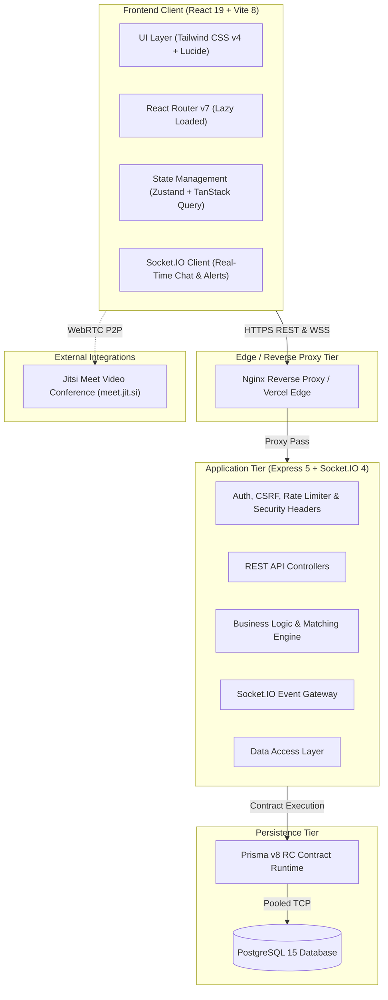
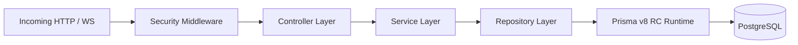
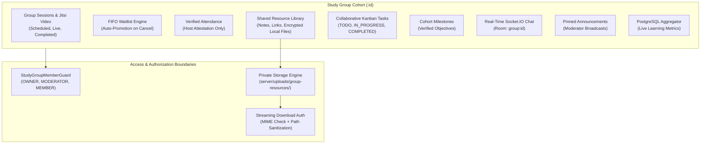
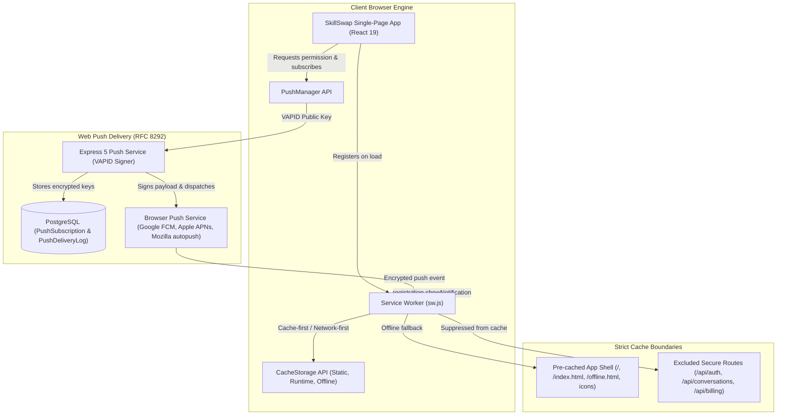

# SkillSwap — System Architecture & Engineering Design

**Version:** 2.1 (Production)  
**Author:** Principal Full-Stack & Systems Architect  
**Repository:** `E:\skillswap`

---

## 1. System Overview

SkillSwap is a full-stack, peer-to-peer reciprocal skill exchange platform designed to facilitate collaborative learning without monetary transactions.



---

## 2. Frontend Architecture

### Technology Stack
- **Framework:** React 19 with TypeScript 6.
- **Build Tool:** Vite 8.3 with `@tailwindcss/vite` plugin.
- **Styling:** Tailwind CSS v4 design tokens with responsive utilities.
- **Routing:** React Router with 100% lazy route code splitting (`React.lazy` + `Suspense`).
- **Data Fetching & Cache:** TanStack Query (`@tanstack/react-query`) with automatic background refetching and cache invalidation.
- **Global Client State:** Zustand store (`useAuthStore`) managing user profile and authenticated status.
- **Feedback & Notifications:** Sonner toast manager with accessible screen-reader alerts.

### Component Hierarchy
```
src/
├── components/
│   ├── app/          # AppLayout, AppHeader, MobileDrawer, MobileBottomBar
│   ├── auth/         # ProtectedRoute, GuestRoute, AuthLayout
│   ├── matching/     # MatchCard, MatchScoreBadge, MatchExplanation
│   ├── messages/     # ChatWindow, MessageList, MessageInput, TypingIndicator
│   ├── onboarding/   # Multi-step wizard (Profile, Teach, Learn, Schedule)
│   ├── requests/     # SwapRequestModal, RequestCard, StatusBadge
│   ├── reviews/      # ReviewModal, RatingStars, ReputationOverview
│   ├── sessions/     # SessionCard, ScheduleModal, RescheduleModal, VideoModal
│   └── ui/           # Modal, LoadingSkeleton, CardSkeleton, EmptyState, ErrorState, Badge
├── hooks/            # Custom query and mutation hooks
├── lib/              # api.ts (Fetch client with auto-CSRF and error normalization)
├── pages/            # 13 top-level application views (Dashboard, Discover, Matches, etc.)
├── store/            # Zustand global stores
└── types/            # TypeScript interfaces and domain models
```

---

## 3. Backend Layered Architecture

The Express 5 server follows a strict layered architectural pattern:



### Layer Responsibilities
1. **Controllers (`server/src/controllers/`):**
   - Parse request inputs, query params, and route parameters.
   - Delegate validation to Zod schemas.
   - Forward business actions to Services.
   - Format and return standardized JSON HTTP envelopes (`{ success, data }`).
2. **Services (`server/src/services/`):**
   - Execute domain business logic and enforce integrity rules.
   - Manage cross-entity transactions (e.g., onboarding, swap acceptance + conversation provisioning).
   - Compute matching scores and session completion states.
   - Emit real-time events through Socket.IO.
3. **Repositories (`server/src/repositories/`):**
   - Encapsulate all database queries and mutations.
   - Interface with the Prisma v8 RC contract runtime.
   - Shield the application from raw database driver nuances.
4. **Middleware (`server/src/middleware/`):**
   - `auth.middleware.ts`: Verifies JWT cookie, extracts authenticated user, checks account active status.
   - `csrf.middleware.ts`: Enforces Double-Submit CSRF token validation on mutating HTTP methods.
   - `rateLimiter.middleware.ts`: Throttles brute-force attempts on sensitive endpoints.
   - `errorHandler.middleware.ts`: Traps unhandled rejections and operational errors into structured JSON.

---

## 4. Two-Way Reciprocal Matching Engine

SkillSwap’s matching algorithm calculates a compatibility score (0–100%) between two users based on three weighted dimensions:

### Compatibility Formula
$$\text{Score} = (W_{\text{skills}} \times S_{\text{skills}}) + (W_{\text{schedule}} \times S_{\text{schedule}}) + (W_{\text{reputation}} \times S_{\text{reputation}})$$

- **$W_{\text{skills}} = 60\%$ (Reciprocal Skill Match):**
  - **Full Reciprocal Match (100 pts):** User A teaches what User B wants to learn AND User B teaches what User A wants to learn.
  - **Partial Match (30 pts):** One-way skill match (insufficient for direct reciprocal swap without complementary goals).
- **$W_{\text{schedule}} = 25\%$ (Availability Overlap):**
  - Compares overlapping slots across Monday through Sunday.
  - Normalized: $\min(100, \text{overlappingSlots} \times 25)$.
- **$W_{\text{reputation}} = 15\%$ (Reputation & Trust):**
  - Blends average star rating (1–5 converted to 0–100) and completed swap count.

### Reciprocal Exchange State Transition
```
User A (Teaches X, Learns Y) <-------------------> User B (Teaches Y, Learns X)
                 |                                      |
                 +---------> SwapRequest <--------------+
                                 |
                          Status: ACCEPTED
                                 |
           +---------------------+---------------------+
           |                                           |
    Session 1 (Direction 1)                     Session 2 (Direction 2)
  User A teaches User B (Skill X)             User B teaches User A (Skill Y)
           |                                           |
    Confirmed by User B                         Confirmed by User A
           \                                           /
            +--------------------+--------------------+
                                 |
                        SwapRequest COMPLETED
                                 |
                    Unlocks Peer 1-5 Star Reviews
```

---

## 5. Real-Time Messaging & Presence Gateway

The Socket.IO gateway (`server/src/websocket/`) provides instantaneous communication:

### Event Architecture
1. **Connection & Auth:** Handshake extracts session JWT from cookie. Rejects unauthenticated or deactivated sockets.
2. **Room Isolation:** Users join private user channels (`user_<id>`) and shared conversation channels (`conversation_<id>`).
3. **Presence Engine:** Tracks connected sockets in memory. Broadcasts `user_presence` transitions when users connect or disconnect.
4. **Message Persistence:** When a message is sent over socket, it is stored in PostgreSQL before being broadcast to room members, guaranteeing zero message loss.
5. **Typing Indicators:** Lightweight transient events (`typing_start`, `typing_stop`) with client-side debounce timers.

---

## 6. Security Architecture & Threat Modeling

| Threat Vector | Mitigation Strategy | Implementation |
|---|---|---|
| **Credential Theft** | Argon2id hashing with unique salt per user | `argon2` with high memory cost ($m=65536$) |
| **Session Hijacking** | Signed JWTs in HTTP-only, SameSite=Lax cookies | `skillswap_token` inaccessible to JavaScript |
| **CSRF Attacks** | Double-Submit CSRF cookie validation | `x-csrf-token` header matched with `skillswap_csrf` |
| **Brute Force / DoS** | IP-based rate limiting + 1MB body limit | `express-rate-limit` + Express JSON body limiter |
| **IDOR / Tampering** | Strict repository ownership filters | Queries enforce `userId = req.user.id` |
| **SQL Injection** | Prisma contract-driven parameterization | Zero raw concatenated SQL strings |
| **XSS Attacks** | React DOM auto-escaping + defensive headers | CSP, `X-Content-Type-Options: nosniff`, `X-Frame-Options: DENY` |
| **Deactivated Access** | Instant middleware and socket revocation | Database check prevents deactivated sessions |

---

## 7. SaaS Monetization, Entitlements & Payment Architecture

```
                    +-----------------------------------+
                    |         Member Action             |
                    | (e.g. Create 4th Active Proposal) |
                    +-----------------+-----------------+
                                      |
                                      v
                    +-----------------------------------+
                    |       EntitlementService          |
                    |  (Checks maxActiveSwaps Quota)    |
                    +-----------------+-----------------+
                                      |
                    +-----------------+-----------------+
                    |                                   |
         Within Quota (<= 3)                 Quota Exceeded (> 3)
                    |                                   |
                    v                                   v
       Proceed to Reciprocal Check           HTTP 403 Forbidden
     & Create Swap Proposal in DB           ("QuotaExceededError")
                                                        |
                                                        v
                                            Client Triggers Upgrade
                                              Modal -> /pricing
```

### Key Architectural Pillars:
1. **`IPaymentProvider` Abstraction:** Encapsulates payment vendors (`StripePaymentProvider` and `MockPaymentProvider`). Keeps controllers and business services independent of vendor SDK specifics.
2. **Deterministic Sandbox Development:** In local testing and CI/CD pipelines (`PAYMENT_PROVIDER=mock`), all checkout flows, customer portal sessions, and webhook deliveries run offline with zero external network calls.
3. **Webhook Idempotency:** Raw request body is captured in `req.rawBody` Buffer for cryptographic HMAC-SHA256 signature validation. Every event ID is logged in PostgreSQL; duplicates are acknowledged with HTTP 200 without duplicate execution.
4. **Safety & Fairness Guarantee:** Core platform features—such as two-way reciprocal verification, user harassment reporting, moderator dispute filing, and account deactivation—are strictly prohibited from being paywalled.

---

## 8. AI-Powered Matching, Personalized Learning & Smart Scheduling Architecture

```
                          +-----------------------------------+
                          |      IAIProvider Interface        |
                          +-----------------+-----------------+
                                            |
                   +------------------------+------------------------+
                   |                                                 |
                   v                                                 v
    +------------------------------+                 +------------------------------+
    | LocalDeterministicAIProvider |                 |       GeminiAIProvider       |
    | (100% Offline / Fast / Free) |                 |    (Google Gemini REST API)  |
    +--------------+---------------+                 +---------------+--------------+
                   ^                                                 |
                   |                    Fails / Times Out            |
                   +─────────────────────────────────────────────────+
```

### Architectural Principles:
1. **Reciprocal Safety Invariant:** AI scoring strictly ranks candidates that already satisfy the fundamental two-way skill reciprocity criteria ($Teaches(A) \cap Learns(B) \ne \emptyset \land Teaches(B) \cap Learns(A) \ne \emptyset$). AI models are architecturally barred from relaxing or bypassing reciprocity requirements.
2. **Dual-Provider Resilience:** In production with configured API credentials, `GeminiAIProvider` handles complex reasoning, with automated transparent fallback to `LocalDeterministicAIProvider` on network errors or timeouts. In CI/CD and offline development, the deterministic provider guarantees 100% test reproducibility with zero external API calls.
3. **Semantic Disambiguation:** Multi-tiered skill catalog resolution disambiguates exact canonical terms (`1.00`), approved aliases (`0.95`, e.g. `React.js` → `React`), domain-adjacent frameworks (`0.50–0.70`), and disjoint disciplines (`<0.30`).
4. **Timezone-Preserving Scheduling:** Time arithmetic maps mutual availability slots between user local times and UTC, clamping to working hours, enforcing a 2-hour notice window, and continuously cross-referencing against booked sessions in PostgreSQL.
5. **Prompt Injection & Credential Isolation:** The AI Learning Assistant operates in a read-only sandboxed prompt environment. Prompts containing injection vectors or credential exfiltration attempts are rejected or sanitized before execution, and LLMs have zero direct database or private conversation access.
6. **Token & Cost Observability:** All generative calls persist prompt and completion token counts, execution latency, and estimated costs to `AIUsageRecord` for real-time administrator auditing.

---

## 9. Learning Analytics & Gamification Architecture

```
  +------------------------------------------------------------------------+
  |                        Verified Platform Events                        |
  +-------------------+--------------------+--------------------+----------+
                      |                    |                    |
    Session Completed | Milestone Done     | Review Submitted   | Goal Achieved
    (Learner & Teacher| (+15 XP)           | (+10 XP)           | (+50 XP)
     +40 XP each)     |                    |                    |
                      v                    v                    v
  +------------------------------------------------------------------------+
  |                    GamificationService (Engine)                        |
  |  1. Verify Event & Check Idempotency Key in XPTransaction              |
  |  2. Execute Atomic Transaction: UserXP Update & XPTransaction Record   |
  |  3. Check & Unlock Achievement Catalog Milestones                      |
  |  4. Update UserStreak (If Enabled)                                     |
  |  5. Dispatch Real-Time In-App Level-Up & Badge Notifications           |
  +-------------------+--------------------+--------------------+----------+
                      |                    |                    |
                      v                    v                    v
  +------------------------------------------------------------------------+
  |                         Persistence Tier                               |
  |   UserXP  |  XPTransaction  |  Achievement  |  UserStreak  |  Goals   |
  +-------------------+--------------------+--------------------+----------+
                      |
                      v
  +------------------------------------------------------------------------+
  |                      Analytics & Privacy Layer                         |
  |  - LearningAnalyticsService (KPI Overview, Heatmap, Skill Breakdown)   |
  |  - GamificationPrivacy Governance (Public Redaction on GET Profile)    |
  +------------------------------------------------------------------------+
```

### Architectural Principles:
1. **Verified Action Exclusivity:** Experience Points (XP) are awarded strictly upon verifiable platform outcomes (completed reciprocal sessions, confirmed reviews, completed roadmap milestones, and accomplished learning goals). Arbitrary client-side XP grants do not exist.
2. **Strict Idempotency:** Every XP transaction enforces a database-level unique constraint on `idempotencyKey` (e.g. `SESSION_LEARN:<sessionId>`, `ROADMAP_MILESTONE:<milestoneId>`). Re-submitting identical confirmations or network retries produces zero duplicate awards.
3. **Non-Linear Leveling Curve:** The level curve scales gracefully from Level 1 (Novice Explorer, 0 XP) to Level 10 (SkillSwap Legend, 5,000 XP) and beyond (+1,500 XP per level), giving early users rapid positive reinforcement while sustaining long-term dedication.
4. **Timezone-Aware Activity Aggregation:** Heatmap calendar generation maps sessions and milestones into the user's localized calendar date (defaulting to the client's detected timezone) with 4-tier intensity scoring.
5. **Privacy by Default:** Sensitive personal learning metrics—such as the 365-day activity heatmap and granular learning goals—are configured to `false` (private) on public profile views until the user explicitly opts in.
6. **Non-Punitive Streak Opt-Out:** Users can toggle streak tracking off at any time. Opting out pauses streak tracking without purging historic longest streaks or disabling access to other platform features.

---

## 10. Community & Study Groups Architecture

```
  +─────────────────────────────────────────────────────────────────────────────+
  |                           Community Forums & Cohorts                         |
  +──────────────────────┬───────────────────────────────┬──────────────────────+
                         |                               |
                         v                               v
           +───────────────────────────+   +───────────────────────────+
           | Public Discussion Forums  |   |    Study Groups Cohorts   |
           | - General & Skill Topics  |   | - Public (Instant Join)   |
           | - DISCUSSION, QUESTION,   |   | - Private (Queue Approval)|
           |   RESOURCE                |   | - Group Roles (Owner, Mod)|
           +─────────────┬─────────────+   +─────────────┬─────────────+
                         |                               |
                         | Bounded Hierarchy (Depth 0-2) | Scoped Access
                         v                               v
           +───────────────────────────+   +───────────────────────────+
           |     Threaded Comments     |   | Group-Only Discussions    |
           | - Soft Delete Protection  |   | - Strict Member Isolation |
           | - Author / Mod Actions    |   | - No Public Leakage       |
           +─────────────┬─────────────+   +───────────────────────────+
                         |
                         +───────────────────────────────+
                         |                               |
                         v                               v
           +───────────────────────────+   +───────────────────────────+
           | Composite-Unique Voting   |   | Question Solution Accepted|
           | - Exactly 1 vote per user |   | - Author / Admin selects  |
           | - Atomic count refresh    |   | - Marks post resolved     |
           +───────────────────────────+   +─────────────┬─────────────+
                                                         |
                                                         | +25 XP Idempotent Award
                                                         v
                                           +───────────────────────────+
                                           | Phase 19 Gamification     |
                                           | XPTransaction Engine      |
                                           +───────────────────────────+
```

### Architectural Principles:
1. **Private Cohort Content Isolation:** Posts, questions, and discussions originating inside private study groups are strictly guarded by membership checks. Global search endpoints and general forum feeds categorically exclude private cohort posts unless the querying user is an active, verified group member or platform administrator.
2. **Bounded Threading Hierarchy & Soft Deletions:** Forum comments enforce a maximum nesting depth of 2 (top-level comment -> reply -> reply). Deleting a comment whose subtree contains active replies converts the record into a soft-deleted placeholder (`isDeleted = true`, displaying `[Comment deleted by user]`), maintaining referential integrity and visual context for conversation participants without orphaned branches.
3. **Composite-Unique Voting Integrity:** Upvoting uses dedicated unique composite constraints (`[postId, userId]` and `[commentId, userId]`) in the database. Race conditions, multi-click spam, or forged payload values can never produce duplicate upvotes or negative totals; casting a vote twice atomically toggles and revokes it.
4. **Idempotent Gamified Q&A Resolution:** Designating an accepted answer on a `QUESTION` post flags `isResolved = true` and triggers a server-side verified award of +25 XP to the helpful contributor via `GamificationService.awardXP` using an idempotency key (`COMMUNITY_ANSWER_ACCEPTED:<commentId>`). Duplicate resolutions or repeated requests yield zero surplus XP.
5. **Resilient Cohort Ownership Succession:** To prevent orphaned study groups, a departing `OWNER` cannot abandon a cohort without either a designated successor or automated promotion. If other members exist, ownership transfers automatically to the highest-ranking active moderator (or the earliest joined member), ensuring ongoing group stewardship.
6. **Centralized Content Moderation & Abuse Integration:** Every community post and comment integrates directly into the platform-wide moderation subsystem (`UserReport`) via `REPORT_POST` and `REPORT_COMMENT`. Repeated reports against the same entity within 24 hours are deduplicated, and platform moderators have authoritative capabilities to lock threads and hide abusive content.

---

## 11. Collaborative Learning Architecture (Phase 21)

SkillSwap's collaborative learning subsystem provides synchronous and asynchronous group interaction while preserving the security and integrity of the core reciprocal exchange model:



### Architectural Principles:
1. **Isolated Multi-User Video Rooms:** Each group session provisions an isolated, dynamically named Jitsi Meet room (`https://meet.jit.si/skillswap-group-<uuid>`). Access is bounded by a time window (starts 15 minutes before the session), and participant URLs are generated server-side.
2. **Deterministic Waitlist Auto-Promotion:** Session capacity limits are strictly enforced. When capacity is reached, new registrants are stored with `status: WAITLIST`. When an existing registrant unregisters, an atomic database transaction queries the earliest waitlisted participant, promotes them to `REGISTERED`, updates their timestamp, and dispatches a notification.
3. **No Automatic Attendance Claims:** Attendance verification (`isVerifiedAttendance = true`) cannot be triggered by joining a video conference, viewing a webpage, or receiving a socket event. Verification requires explicit host or moderator confirmation, preserving high data integrity for learning achievements.
4. **Secure File Storage & Streaming Downloads:** Shared files (PDFs, Markdown, Images up to 10MB) are stored on the local disk under `server/uploads/group-resources/` with cryptographic UUID filenames. Files are never placed in a public static directory. Downloads are routed through `GET /api/community/groups/:id/resources/:resourceId/download`, which authenticates user session and validates active group membership before streaming chunks.
5. **Cohort-Scoped Real-Time Socket Rooms:** Group messaging uses dedicated Socket.IO rooms `group:<groupId>`. The socket gateway validates that the connecting user is an active member before permitting room subscription (`group:join`), preventing message leakage across groups.
6. **Zero Reciprocal Dilution:** Collaborative features enrich study groups without modifying or weakening the core 1-on-1 reciprocal skill exchange guarantees, mutual confirmation protocols, or reputation engine.

---

## 12. Progressive Web App & Web Push Architecture (Phase 22)

SkillSwap's PWA architecture delivers an installable, offline-capable experience powered by standards-based browser APIs without requiring a hybrid native wrapper or third-party proprietary dependencies.



### Architectural Principles:
1. **Zero Native Conversion:** SkillSwap operates entirely through standard Web specifications: Web App Manifest, Service Worker API, Push API, Notifications API, and CacheStorage API.
2. **Explicit Cache Isolation & Security Boundaries:** The Service Worker categorically excludes sensitive paths (`/api/auth/*`, `/api/conversations/*`, `/api/messages/*`, `/api/billing/*`, `/api/admin/*`, `/api/sessions/*`, and `/socket.io/*`). Non-GET requests and requests carrying authorization or session cookies are never cached.
3. **Session Cache Eviction:** When a user logs out (`useLogout`), the client immediately calls `clearOfflineCache()`, which instructs `CacheStorage` to delete all runtime caches, preventing private data leakage on shared public computers.
4. **VAPID RFC 8292 Cryptographic Exchange:** Push notifications use NIST P-256 elliptic curve asymmetric encryption. Private keys remain strictly enclosed within server environment configuration (`VAPID_PRIVATE_KEY`), while public keys are distributed to clients for browser registration.
5. **Self-Healing Subscription Pruning:** Device endpoints rejected with HTTP 410 (Gone) or 404 (Not Found) by browser push services are treated as expired or revoked; the server automatically purges the invalid record from `PushSubscription` and logs status as `EXPIRED` in `PushDeliveryLog`.
6. **Disruption Protection during Live Sessions:** Service worker update refreshes explicitly suppress automatic reloads if a user is actively participating in an ongoing video session (`/sessions?call=`).


