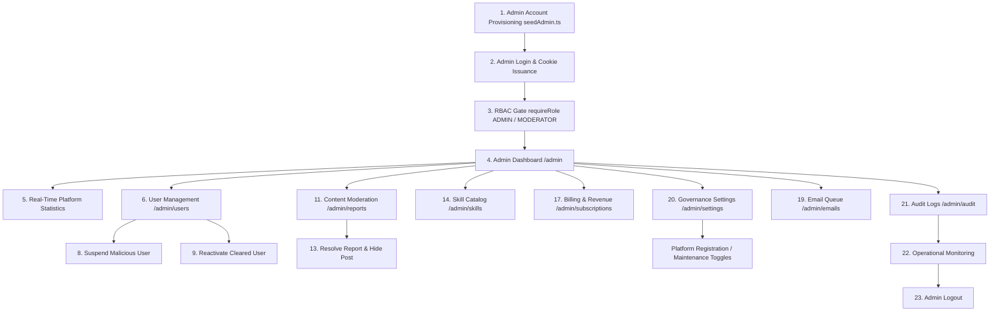

# SkillSwap — Complete Administrator Workflow & Platform Governance Guide

**Version:** 1.0.0 (Production Blueprint)  
**Target Environment:** React 19 Frontend + Express 5 Backend + PostgreSQL 15 Database  
**Author:** Principal Full-Stack Architect & Application Security Engineer  
**Evaluation Date:** 2026-11-06  

---

## 1. Role-Permission Matrix

SkillSwap enforces a strict 3-tier Role-Based Access Control (RBAC) model:

| Capability / Resource Area | Standard User (`USER`) | Community Moderator (`MODERATOR`) | Platform Administrator (`ADMIN`) |
| :--- | :---: | :---: | :---: |
| **Browse Directory & Matching** | ✅ Allowed | ✅ Allowed | ✅ Allowed |
| **Propose Swaps & Schedule Sessions** | ✅ Allowed | ✅ Allowed | ✅ Allowed |
| **Participate in Community Forums** | ✅ Allowed | ✅ Allowed | ✅ Allowed |
| **Report Abuse / Inappropriate Content**| ✅ Allowed | ✅ Allowed | ✅ Allowed |
| **Access Admin Center (`/admin`)** | ❌ 403 Forbidden | ✅ Allowed | ✅ Allowed |
| **View Platform Analytics & Metrics** | ❌ 403 Forbidden | ✅ Overview Only | ✅ Full Platform Access |
| **Inspect Abuse Report Queue** | ❌ 403 Forbidden | ✅ Allowed | ✅ Allowed |
| **Resolve / Dismiss Abuse Reports** | ❌ 403 Forbidden | ✅ Allowed | ✅ Allowed |
| **Hide Flagged Community Posts** | ❌ 403 Forbidden | ✅ Allowed | ✅ Allowed |
| **Suspend Standard Users** | ❌ 403 Forbidden | ❌ 403 Forbidden | ✅ Allowed |
| **Reactivate Suspended Users** | ❌ 403 Forbidden | ❌ 403 Forbidden | ✅ Allowed |
| **Promote / Change User Roles** | ❌ 403 Forbidden | ❌ 403 Forbidden | ✅ Allowed |
| **Curate Skill Catalog (Add/Disable)** | ❌ 403 Forbidden | ❌ 403 Forbidden | ✅ Allowed |
| **Manage Governance Settings (Toggles)** | ❌ 403 Forbidden | ❌ 403 Forbidden | ✅ Allowed |
| **View Revenue & MRR/ARR Analytics** | ❌ 403 Forbidden | ❌ 403 Forbidden | ✅ Allowed |
| **Process Transactional Email Queue** | ❌ 403 Forbidden | ❌ 403 Forbidden | ✅ Allowed |
| **Inspect Immutable Audit Logs** | ❌ 403 Forbidden | ❌ 403 Forbidden | ✅ Allowed |

---

## 2. Administrator Workflow Flowchart

---

## 3. Comprehensive 23-Step Administrator Journey Breakdown

---

### Step 1 — Admin Account Provisioning
- **Admin Action:** DevOps initializes platform with a seed administrator account via CLI seeder or automated migration hook.
- **Frontend Route:** N/A (CLI command: `npm --prefix server run seed:admin`).
- **React Component:** None.
- **API Endpoint:** CLI script [`server/src/prisma/seedAdmin.ts`](file:///e:/skillswap/server/src/prisma/seedAdmin.ts).
- **Backend Authorization:** Direct database connection; creates super-admin if none exists.
- **Service Logic:** Hashes default or environment password (`INITIAL_ADMIN_PASSWORD` or fallback) with Argon2id; sets `role = 'ADMIN'`, `isOnboarded = true`, `isActive = true`.
- **Database Operations:** Inserts or upserts into `User` table (`email = 'admin@skillswap.local'`, `role = 'ADMIN'`).
- **Result:** Initial administrator credential created with zero plaintext storage.
- **Security Restrictions:** Script logs warning if default password is used; production environment requires 32+ character secrets.

---

### Step 2 — Admin Authentication
- **Admin Action:** Administrator navigates to `/login` and submits admin credentials.
- **Frontend Route:** `/login`
- **React Component:** [`client/src/pages/Login.tsx`](file:///e:/skillswap/client/src/pages/Login.tsx).
- **API Endpoint:** `POST /api/auth/login`
- **Backend Authorization:** `AuthController.login` in [`auth.controller.ts`](file:///e:/skillswap/server/src/controllers/auth.controller.ts).
- **Service Logic:** Validates email and verifies Argon2id password hash; generates JWT with claims `{ userId, role: 'ADMIN' }`.
- **Database Operations:** Reads `User` where `email = :email`.
- **Result:** HTTP 200 OK; sets signed `skillswap_token` (HTTP-only cookie) and `skillswap_csrf` cookie.
- **Security Restrictions:** Rate limited to 15 attempts / 15 minutes; failed logins logged with client IP.

---

### Step 3 — Role-Based Authorization
- **Admin Action:** Client initiates navigation to `/admin`.
- **Frontend Route:** `/admin/*`
- **React Component:** [`client/src/components/auth/AdminRoute.tsx`](file:///e:/skillswap/client/src/components/auth/AdminRoute.tsx).
- **API Endpoint:** Checked by backend middleware `requireRole(['ADMIN', 'MODERATOR'])` in [`auth.middleware.ts`](file:///e:/skillswap/server/src/middleware/auth.middleware.ts).
- **Backend Authorization:** Decodes JWT cookie; inspects `req.user.role`.
- **Service Logic:** If `role` is not `ADMIN` or `MODERATOR`, immediately terminates request.
- **Database Operations:** None (stateless token inspection with user verification).
- **Result:** If authorized, renders admin layout; if standard user (`USER`), returns HTTP 403 Forbidden error envelope.
- **Security Restrictions:** Client-side route guard prevents UI rendering; server middleware strictly blocks API access.

---

### Step 4 — Admin Dashboard Overview
- **Admin Action:** Administrator views the central command center at `/admin`.
- **Frontend Route:** `/admin`
- **React Component:** [`client/src/pages/admin/AdminDashboard.tsx`](file:///e:/skillswap/client/src/pages/admin/AdminDashboard.tsx).
- **API Endpoint:** `GET /api/admin/overview`
- **Backend Authorization:** `requireRole(['ADMIN', 'MODERATOR'])`.
- **Service Logic:** `AdminService.getOverview` aggregates live platform health indicators in parallel.
- **Database Operations:** Parallel counts across `User`, `SwapRequest`, `Session`, `CommunityPost`, and `UserReport`.
- **Result:** HTTP 200 OK with `{ totalUsers, activeSwaps, completedSessions, pendingReports, totalPosts }`.
- **Security Restrictions:** Non-admin/moderator users blocked with 403.

---

### Step 5 — Platform Statistics & Trends
- **Admin Action:** Administrator inspects growth charts, daily swap activity, session completion rates, and active user retention.
- **Frontend Route:** `/admin`
- **React Component:** `AdminDashboard.tsx` (Metrics Section).
- **API Endpoint:** `GET /api/admin/overview`
- **Backend Authorization:** `requireRole(['ADMIN', 'MODERATOR'])`.
- **Service Logic:** Calculates ratio of successful completions to cancellations and unread reports.
- **Database Operations:** Grouped queries on `Session` by `status` and `SwapRequest` by `status`.
- **Result:** Real-time metrics breakdown displayed in styled cards.
- **Security Restrictions:** Read-only access; no mutation permitted from overview endpoint.

---

### Step 6 — User Search & Filter
- **Admin Action:** Administrator searches for users by username, email, role, or suspension status.
- **Frontend Route:** `/admin/users`
- **React Component:** [`client/src/pages/admin/AdminUsers.tsx`](file:///e:/skillswap/client/src/pages/admin/AdminUsers.tsx).
- **API Endpoint:** `GET /api/admin/users?search=bob&role=USER&isSuspended=false`
- **Backend Authorization:** `requireRole(['ADMIN'])`.
- **Service Logic:** `AdminService.listUsers` with pagination and filter criteria.
- **Database Operations:** Queries `User` table joined with teaching/learning skill counts and reports count.
- **Result:** Paginated list of users with account status tags and action menus.
- **Security Restrictions:** Moderators cannot access user management endpoints (403 Forbidden).

---

### Step 7 — User Profile Review
- **Admin Action:** Administrator clicks on a user row to review registration date, verified reputation, session history, and abuse reports filed against them.
- **Frontend Route:** `/admin/users` (Detail Modal / Drawer).
- **React Component:** `AdminUsers.tsx` (UserDetailModal).
- **API Endpoint:** `GET /api/admin/users/:id`
- **Backend Authorization:** `requireRole(['ADMIN'])`.
- **Service Logic:** `AdminService.getUserDetails`.
- **Database Operations:** Reads `User` record, linked `Review` testimonials, and `UserReport` records.
- **Result:** Complete user audit trail displayed for moderation review.
- **Security Restrictions:** Admin-only view; never exposes password hashes or raw auth tokens.

---

### Step 8 — User Suspension
- **Admin Action:** Administrator suspends a malicious or spamming user with a mandatory reason note ("Repeated offensive conduct in study groups").
- **Frontend Route:** `/admin/users`
- **React Component:** `AdminUsers.tsx` (SuspendUserDialog).
- **API Endpoint:** `POST /api/admin/users/:id/suspend`
- **Backend Authorization:** `requireRole(['ADMIN'])`.
- **Service Logic:** `AdminService.suspendUser` checks that target user is not self (preventing accidental admin lockout); sets `isSuspended = true`, records reason.
- **Database Operations:** 
  1. Updates `User` setting `isSuspended = true`, `suspendedReason = "..."`.
  2. Inserts into `AdminAuditLog` (`actorId`, `action = "USER_SUSPEND"`, `targetId = :id`, `metadata`).
- **Result:** HTTP 200 OK; target user's active socket connections are severed; subsequent API requests by target user return 403 Forbidden.
- **Security Restrictions:** Admin cannot suspend their own account (400 Bad Request); moderators cannot suspend users (403 Forbidden).

---

### Step 9 — User Reactivation
- **Admin Action:** Administrator clears an appeal and reactivates a previously suspended user.
- **Frontend Route:** `/admin/users`
- **React Component:** `AdminUsers.tsx`.
- **API Endpoint:** `POST /api/admin/users/:id/reactivate`
- **Backend Authorization:** `requireRole(['ADMIN'])`.
- **Service Logic:** `AdminService.reactivateUser`.
- **Database Operations:**
  1. Updates `User` setting `isSuspended = false`, `suspendedReason = null`.
  2. Inserts into `AdminAuditLog` (`action = "USER_REACTIVATE"`).
- **Result:** HTTP 200 OK; user can log in and participate in skill swaps again.
- **Security Restrictions:** Admin-only operation.

---

### Step 10 — Role Management
- **Admin Action:** Administrator promotes a trusted user to `MODERATOR` or demotes a moderator to `USER`.
- **Frontend Route:** `/admin/users`
- **React Component:** `AdminUsers.tsx` (RoleSelector).
- **API Endpoint:** `PATCH /api/admin/users/:id/role`
- **Backend Authorization:** `requireRole(['ADMIN'])`.
- **Service Logic:** `AdminService.updateUserRole` validates role is one of `USER`, `MODERATOR`, `ADMIN`.
- **Database Operations:**
  1. Updates `User.role = :newRole`.
  2. Inserts into `AdminAuditLog` (`action = "USER_ROLE_CHANGE"`).
- **Result:** Target user's role updated; reflected on next token refresh.
- **Security Restrictions:** Super-admin cannot demote their own account to prevent lockouts.

---

### Step 11 — Community Moderation Queue
- **Admin Action:** Moderator or Admin navigates to `/admin/reports` to inspect pending user-submitted abuse reports.
- **Frontend Route:** `/admin/reports`
- **React Component:** [`client/src/pages/admin/AdminReports.tsx`](file:///e:/skillswap/client/src/pages/admin/AdminReports.tsx).
- **API Endpoint:** `GET /api/admin/reports?status=PENDING`
- **Backend Authorization:** `requireRole(['ADMIN', 'MODERATOR'])`.
- **Service Logic:** `AdminService.getReports`.
- **Database Operations:** Reads `UserReport` joined with reporter `User` and reported `User` / `CommunityPost`.
- **Result:** Queue of pending complaints sorted by severity and timestamp.
- **Security Restrictions:** Both Admins and Moderators have authorized access.

---

### Step 12 — Report Review
- **Admin Action:** Moderator inspects reported content (e.g. an inappropriate forum post or harassment in swap messages).
- **Frontend Route:** `/admin/reports`
- **React Component:** `AdminReports.tsx` (ReportDetailView).
- **API Endpoint:** `GET /api/admin/reports/:id`
- **Backend Authorization:** `requireRole(['ADMIN', 'MODERATOR'])`.
- **Service Logic:** Fetches the full context snapshot associated with the report.
- **Database Operations:** Reads report details and linked entities.
- **Result:** Contextual view of reporter complaint, evidence text, and reported entity.
- **Security Restrictions:** Accessible to Moderators and Admins.

---

### Step 13 — Report Resolution & Content Action
- **Admin Action:** Moderator resolves the report by either (1) Dismissing as unfounded, or (2) Taking action (e.g. hiding the offensive post).
- **Frontend Route:** `/admin/reports`
- **React Component:** `AdminReports.tsx` (ResolveReportModal).
- **API Endpoint:** `PATCH /api/admin/reports/:id`
- **Backend Authorization:** `requireRole(['ADMIN', 'MODERATOR'])`.
- **Service Logic:** `AdminService.resolveReport` updates report status (`RESOLVED` or `DISMISSED`) with moderator action notes.
- **Database Operations:**
  1. Updates `UserReport` setting `status = :status`, `resolvedAt = NOW()`, `moderatorNotes = :notes`.
  2. If post action taken: updates `CommunityPost` setting `isLocked = true` or `isHidden = true`.
  3. Inserts into `AdminAuditLog` (`action = "REPORT_RESOLVED"`).
- **Result:** Report removed from pending queue; moderation action recorded.
- **Security Restrictions:** Both Admins and Moderators authorized.

---

### Step 14 — Skill Catalog Management
- **Admin Action:** Administrator navigates to `/admin/skills` to add a new canonical skill ("Next.js") or soft-disable an obsolete skill.
- **Frontend Route:** `/admin/skills`
- **React Component:** [`client/src/pages/admin/AdminSkills.tsx`](file:///e:/skillswap/client/src/pages/admin/AdminSkills.tsx).
- **API Endpoint:** `POST /api/admin/skills` or `PATCH /api/admin/skills/:id/toggle`
- **Backend Authorization:** `requireRole(['ADMIN'])`.
- **Service Logic:** `AdminService.createSkill` or `toggleSkill`; clears in-memory skill cache in `SkillRepository`.
- **Database Operations:**
  1. Inserts into `Skill` (`name = "Next.js"`, `category = "Development"`, `isActive = true`).
  2. Or updates `Skill.isActive = !isActive`.
  3. Inserts into `AdminAuditLog`.
- **Result:** HTTP 201 Created; in-memory cache invalidates immediately; skill appears in onboarding and discovery dropdowns.
- **Security Restrictions:** Admin-only operation.

---

### Step 15 — Study Group Moderation
- **Admin Action:** Administrator audits active study groups, flags groups violating community standards, or reassigns abandoned group ownership.
- **Frontend Route:** `/admin` (Group Governance).
- **React Component:** `AdminDashboard.tsx`.
- **API Endpoint:** `GET /api/community/groups` and `DELETE /api/community/groups/:id`
- **Backend Authorization:** `requireRole(['ADMIN'])`.
- **Service Logic:** Removes group and cascading relationships if severe terms violation occurs.
- **Database Operations:** Soft-deletes or archives `StudyGroup`.
- **Result:** Group removed from public discovery.
- **Security Restrictions:** Admin-only operation.

---

### Step 16 — Session Monitoring
- **Admin Action:** Administrator reviews platform session metrics (completed sessions, reschedule frequency, average session duration, no-show rates).
- **Frontend Route:** `/admin`
- **React Component:** `AdminDashboard.tsx` (SessionAnalyticsCard).
- **API Endpoint:** `GET /api/admin/overview`
- **Backend Authorization:** `requireRole(['ADMIN', 'MODERATOR'])`.
- **Service Logic:** Aggregates session counts grouped by status (`SCHEDULED`, `COMPLETED`, `CANCELLED`).
- **Database Operations:** Counts on `Session` table.
- **Result:** Aggregated session fulfillment percentage.
- **Security Restrictions:** Read-only access.

---

### Step 17 — Subscription & Monetization Monitoring
- **Admin Action:** Administrator reviews SaaS subscription performance at `/admin/subscriptions`.
- **Frontend Route:** `/admin/subscriptions`
- **React Component:** [`client/src/pages/admin/AdminSubscriptions.tsx`](file:///e:/skillswap/client/src/pages/admin/AdminSubscriptions.tsx).
- **API Endpoint:** `GET /api/admin/billing/overview`
- **Backend Authorization:** `requireRole(['ADMIN'])`.
- **Service Logic:** `BillingService.getAdminMetrics` aggregates active subscriptions, trial counts, and past due accounts.
- **Database Operations:** Reads `UserSubscription` joined with `SubscriptionPlan`.
- **Result:** Breakdown of subscribers by tier (`FREE`, `PRO`, `PREMIUM`) and subscriber churn.
- **Security Restrictions:** Admin-only operation; standard users and moderators receive 403 Forbidden.

---

### Step 18 — Revenue Analytics (MRR / ARR)
- **Admin Action:** Administrator inspects financial run rate, Monthly Recurring Revenue (MRR), and Annual Recurring Revenue (ARR).
- **Frontend Route:** `/admin/subscriptions`
- **React Component:** `AdminSubscriptions.tsx` (RevenueMetricsChart).
- **API Endpoint:** `GET /api/admin/billing/overview`
- **Backend Authorization:** `requireRole(['ADMIN'])`.
- **Service Logic:** Calculates MRR based on active monthly ($15/mo) and annual plans ($144/yr) normalized to 30 days.
- **Database Operations:** Sums active subscription amounts in `UserSubscription`.
- **Result:** Live MRR, ARR, and subscriber metrics.
- **Security Restrictions:** Strictly admin-only; financial metrics never leaked to non-admin users.

---

### Step 19 — Transactional Email Administration
- **Admin Action:** Administrator inspects enqueued transactional emails (welcome emails, session reminders) and manually triggers pending job processing.
- **Frontend Route:** `/admin/emails`
- **React Component:** [`client/src/pages/admin/AdminEmails.tsx`](file:///e:/skillswap/client/src/pages/admin/AdminEmails.tsx).
- **API Endpoint:** `GET /api/admin/emails` and `POST /api/admin/emails/process-pending`
- **Backend Authorization:** `requireRole(['ADMIN'])`.
- **Service Logic:** `EmailService.processPendingQueue` flushes pending email jobs with retry backoff.
- **Database Operations:** Reads and updates `EmailQueue` setting `status = 'SENT'` and `sentAt = NOW()`.
- **Result:** Email delivery logs and job statuses updated in real-time.
- **Security Restrictions:** Admin-only operation.

---

### Step 20 — Platform Governance Settings
- **Admin Action:** Administrator toggles emergency settings (e.g. disable new user registrations during maintenance, enable maintenance banner).
- **Frontend Route:** `/admin/settings`
- **React Component:** [`client/src/pages/admin/AdminSettings.tsx`](file:///e:/skillswap/client/src/pages/admin/AdminSettings.tsx).
- **API Endpoint:** `GET /api/admin/settings` and `PATCH /api/admin/settings`
- **Backend Authorization:** `requireRole(['ADMIN'])`.
- **Service Logic:** `PlatformSettingsService.updateSettings` writes key-value configuration flags.
- **Database Operations:** Upserts into `PlatformSetting` (`key`, `value`).
- **Result:** Settings take effect immediately across all client sessions without requiring a server reboot.
- **Security Restrictions:** Admin-only operation.

---

### Step 21 — Immutable Audit Logs
- **Admin Action:** Administrator inspects the system audit log at `/admin/audit` to review sensitive administrative actions.
- **Frontend Route:** `/admin/audit`
- **React Component:** [`client/src/pages/admin/AdminAuditLogs.tsx`](file:///e:/skillswap/client/src/pages/admin/AdminAuditLogs.tsx).
- **API Endpoint:** `GET /api/admin/audit?limit=25`
- **Backend Authorization:** `requireRole(['ADMIN'])`.
- **Service Logic:** `AdminService.getAuditLogs` retrieves chronological log of admin mutations.
- **Database Operations:** Reads `AdminAuditLog` table ordered by `createdAt DESC`.
- **Result:** Immutable table showing Actor Name, Action Type, Target ID, IP Address, Timestamp, and Details JSON.
- **Security Restrictions:** Audit log records can never be deleted or modified via API (append-only ledger).

---

### Step 22 — Security & Operational Monitoring
- **Admin Action:** Administrator monitors system health, database query latency, and error logs via the health telemetry endpoint.
- **Frontend Route:** `/admin` (SystemHealthCard).
- **React Component:** `AdminDashboard.tsx`.
- **API Endpoint:** `GET /api/health`
- **Backend Authorization:** Public/Admin health monitoring.
- **Service Logic:** `HealthService.getHealthStatus` measures active database connection pool latency and memory consumption.
- **Database Operations:** Simple `SELECT 1` ping.
- **Result:** `{ status: "healthy", database: "connected", latencyMs: 2.4, uptime: 84200 }`.
- **Security Restrictions:** System metrics sanitized; no connection strings or credentials exposed.

---

### Step 23 — Admin Logout
- **Admin Action:** Administrator logs out of administrative session.
- **Frontend Route:** `/admin` (Header Profile Menu).
- **React Component:** [`client/src/components/app/AppHeader.tsx`](file:///e:/skillswap/client/src/components/app/AppHeader.tsx).
- **API Endpoint:** `POST /api/auth/logout`
- **Backend Authorization:** Standard auth logout.
- **Service Logic:** Invalidates session and clears cookies with explicit path and sameSite attributes.
- **Database Operations:** None.
- **Result:** `skillswap_token` and `skillswap_csrf` cleared; admin redirected to `/login`.
- **Security Restrictions:** Subsequent attempts to access `/admin` immediately redirect to `/login`.

