# SkillSwap — Complete Database Schema & Entity Relationship Architecture

**Version:** 1.0.0 (Production Blueprint)  
**Database Engine:** PostgreSQL 15+  
**ORM Framework:** Prisma v8 RC Contract Specification (`@prisma/orm-postgres 8.0.0-rc.14`)  
**Contract Hash:** `fd2abf5994e5ebd4acc6b7e04eed020a97e15e803c86db9d8f4701a56934fdfb`  
**Author:** Principal Database Architect & Data Engineer  
**Evaluation Date:** 2026-11-06  

---

## 1. High-Level Entity Relationship Diagram (ERD)

```mermaid
erDiagram
    User ||--o{ UserTeachingSkill : teaches
    User ||--o{ UserLearningSkill : learns
    User ||--o{ UserAvailability : schedules
    User ||--o{ SwapRequest : sends_proposals
    User ||--o{ SwapRequest : receives_proposals
    User ||--o{ ConversationParticipant : participates_in
    User ||--o{ Message : sends_messages
    User ||--o{ Session : hosts_sessions
    User ||--o{ Session : attends_sessions
    User ||--o{ Review : writes_reviews
    User ||--o{ Review : receives_reviews
    User ||--o{ Notification : receives_alerts
    User ||--o| UserNotificationPreference : configures
    User ||--o| UserXP : progresses
    User ||--o{ XPTransaction : logs_xp
    User ||--o{ UserAchievement : unlocks
    User ||--o{ LearningGoal : sets_goals
    User ||--o| UserStreak : tracks_streak
    User ||--o| GamificationPrivacy : sets_privacy
    User ||--o{ CommunityPost : authors_posts
    User ||--o{ CommunityComment : writes_comments
    User ||--o{ CommunityVote : casts_votes
    User ||--o{ StudyGroupMember : joins_groups
    User ||--o| UserSubscription : subscribes
    User ||--o{ BillingInvoice : receives_invoices
    User ||--o{ PushSubscription : registers_devices

    Skill ||--o{ UserTeachingSkill : taught_as
    Skill ||--o{ UserLearningSkill : learned_as
    Skill ||--o{ SkillAlias : has_aliases

    SwapRequest ||--o{ Session : schedules
    SwapRequest ||--o| Conversation : originates

    Conversation ||--o{ ConversationParticipant : contains
    Conversation ||--o{ Message : holds

    Session ||--o{ Review : reviewed_in

    Achievement ||--o{ UserAchievement : awards

    SubscriptionPlan ||--o{ UserSubscription : defines_tier

    StudyGroup ||--o{ StudyGroupMember : has_members
    StudyGroup ||--o{ GroupSession : hosts_sessions
    StudyGroup ||--o{ GroupResource : shares_resources
    StudyGroup ||--o{ GroupTask : organizes_tasks
    StudyGroup ||--o{ GroupMilestone : tracks_milestones
    StudyGroup ||--o{ GroupMessage : streams_chat
    StudyGroup ||--o{ GroupAnnouncement : publishes_announcements

    GroupSession ||--o{ GroupSessionParticipant : registers
```

---

## 2. Core Domain Models Breakdown

### 2.1 User & Identity Management
- **`User`:**
  - **Primary Key:** `id` (Int, Autoincrement).
  - **Unique Constraints:** `email` (VarChar 255), `username` (VarChar 50).
  - **Key Attributes:** `passwordHash` (Argon2id string), `name`, `bio`, `avatarUrl`, `location`, `role` (`USER`, `MODERATOR`, `ADMIN`), `isOnboarded` (Boolean), `isActive` (Boolean), `isSuspended` (Boolean), `averageRating` (Float, default 0), `totalReviews` (Int, default 0), `completedTeachingSessions` (Int, default 0).
  - **Indexes:** `idx_user_email` (B-tree on email), `idx_user_username` (B-tree on username), `idx_user_role` (B-tree on role), composite `idx_user_active_suspended` on `(isActive, isSuspended)`.
  - **Data Ownership:** Core identity root for all user assets.

- **`UserNotificationPreference`:**
  - **Primary Key:** `id` (Int, Autoincrement).
  - **Foreign Key:** `userId` (Int, Unique, references `User.id` with `onDelete: Cascade`).
  - **Key Attributes:** Boolean toggles: `emailNotifications`, `swapRequests`, `sessionReminders`, `newMessages`, `marketingEmails`, `pushSwapRequests`, `pushMessages`, `pushSessions`, `pushReminders`, `pushGroupActivity`.

---

### 2.2 Skill Taxonomy & Matching Models
- **`Skill`:**
  - **Primary Key:** `id` (Int, Autoincrement).
  - **Unique Constraints:** `name` (VarChar 100).
  - **Key Attributes:** `category` (`Development`, `Design`, `Creative`, `Business`, `Languages`), `description`, `isActive` (Boolean).
  - **Indexes:** `idx_skill_category`, `idx_skill_active`.

- **`UserTeachingSkill`:**
  - **Primary Key:** `id` (Int, Autoincrement).
  - **Foreign Keys:** `userId` (`User.id`), `skillId` (`Skill.id`).
  - **Unique Constraint:** Composite unique `(userId, skillId)` preventing duplicate skills taught per user.
  - **Key Attributes:** `proficiency` (`BEGINNER`, `INTERMEDIATE`, `ADVANCED`, `EXPERT`).

- **`UserLearningSkill`:**
  - **Primary Key:** `id` (Int, Autoincrement).
  - **Foreign Keys:** `userId` (`User.id`), `skillId` (`Skill.id`).
  - **Unique Constraint:** Composite unique `(userId, skillId)` preventing duplicate learning skills per user.
  - **Key Attributes:** `priority` (`LOW`, `MEDIUM`, `HIGH`).

- **`UserAvailability`:**
  - **Primary Key:** `id` (Int, Autoincrement).
  - **Foreign Key:** `userId` (`User.id`).
  - **Key Attributes:** `dayOfWeek` (`MONDAY` through `SUNDAY`), `startTime` (`09:00`), `endTime` (`17:00`), `timezone` (`America/New_York`).
  - **Indexes:** `idx_availability_user_day` on `(userId, dayOfWeek)`.

- **`SkillAlias`:**
  - **Primary Key:** `id` (Int, Autoincrement).
  - **Foreign Key:** `canonicalSkillId` (`Skill.id`).
  - **Unique Constraint:** `alias` (VarChar 100, e.g. "React.js" -> "React").
  - **Key Attributes:** `isApproved` (Boolean).

---

### 2.3 Swap Requests & Scheduling Lifecycle
- **`SwapRequest`:**
  - **Primary Key:** `id` (Int, Autoincrement).
  - **Foreign Keys:** `senderId` (`User.id`), `receiverId` (`User.id`), `senderSkillId` (`Skill.id`), `receiverSkillId` (`Skill.id`).
  - **Key Attributes:** `message`, `status` (`PENDING`, `ACCEPTED`, `REJECTED`, `CANCELLED`, `COMPLETED`), `createdAt`, `updatedAt`.
  - **Indexes:** Composite index `idx_swap_sender_status` on `(senderId, status)`, `idx_swap_receiver_status` on `(receiverId, status)`.

- **`Session`:**
  - **Primary Key:** `id` (Int, Autoincrement).
  - **Foreign Keys:** `swapRequestId` (`SwapRequest.id`), `hostId` (`User.id`), `attendeeId` (`User.id`), `teachingSkillId` (`Skill.id`).
  - **Key Attributes:** `startTime`, `endTime`, `status` (`SCHEDULED`, `RESCHEDULE_PENDING`, `COMPLETED`, `CANCELLED`), `jitsiRoom` (tokenized string), `isHostConfirmed`, `isAttendeeConfirmed`, `completedAt`.
  - **Indexes:** `idx_session_host` on `(hostId, startTime)`, `idx_session_attendee` on `(attendeeId, startTime)`.

- **`Review`:**
  - **Primary Key:** `id` (Int, Autoincrement).
  - **Foreign Keys:** `sessionId` (`Session.id`), `reviewerId` (`User.id`), `revieweeId` (`User.id`).
  - **Unique Constraint:** Composite unique `(sessionId, reviewerId)` guaranteeing exactly 1 review per participant per session.
  - **Key Attributes:** `rating` (Int, 1 to 5), `comment` (VarChar 1000), `createdAt`.

---

### 2.4 Real-Time Conversations & Chat
- **`Conversation`:**
  - **Primary Key:** `id` (Int, Autoincrement).
  - **Foreign Key:** `swapRequestId` (`SwapRequest.id`, Optional).
  - **Key Attributes:** `title`, `createdAt`, `updatedAt`.

- **`ConversationParticipant`:**
  - **Primary Key:** `id` (Int, Autoincrement).
  - **Foreign Keys:** `conversationId` (`Conversation.id`), `userId` (`User.id`).
  - **Unique Constraint:** Composite unique `(conversationId, userId)`.
  - **Key Attributes:** `lastReadAt` (Timestamp).

- **`Message`:**
  - **Primary Key:** `id` (Int, Autoincrement).
  - **Foreign Keys:** `conversationId` (`Conversation.id`), `senderId` (`User.id`).
  - **Key Attributes:** `content` (Text), `clientMessageId` (VarChar 100, deduplication token), `createdAt`.
  - **Indexes:** `idx_message_conv_created` on `(conversationId, createdAt DESC)`.

---

### 2.5 Community Forums & Study Cohorts
- **`CommunityPost`:**
  - **Primary Key:** `id` (Int, Autoincrement).
  - **Foreign Key:** `authorId` (`User.id`), `studyGroupId` (`StudyGroup.id`, Nullable).
  - **Key Attributes:** `title`, `content` (Markdown Text), `postType` (`DISCUSSION`, `QUESTION`, `RESOURCE`), `category`, `upvotesCount`, `commentsCount`, `isLocked`, `isHidden`.
  - **Indexes:** `idx_post_category`, `idx_post_created` on `(createdAt DESC)`, `idx_post_group` on `(studyGroupId)`.

- **`PostComment`:**
  - **Primary Key:** `id` (Int, Autoincrement).
  - **Foreign Keys:** `postId` (`CommunityPost.id`), `authorId` (`User.id`), `parentId` (`PostComment.id`, Nullable self-relation for threaded replies).
  - **Key Attributes:** `content`, `isAccepted` (Boolean, marked as solution), `upvotesCount`, `createdAt`.

- **`CommunityVote`:**
  - **Primary Key:** `id` (Int, Autoincrement).
  - **Foreign Keys:** `userId` (`User.id`), `postId` (`CommunityPost.id`, Nullable), `commentId` (`PostComment.id`, Nullable).
  - **Unique Constraints:** Composite unique `(userId, postId)` and `(userId, commentId)`.

- **`StudyGroup`:**
  - **Primary Key:** `id` (Int, Autoincrement).
  - **Foreign Key:** `ownerId` (`User.id`).
  - **Key Attributes:** `name`, `description`, `isPrivate` (Boolean), `skillId` (`Skill.id`, Nullable), `memberCount`, `maxMembers`.

- **`StudyGroupMember`:**
  - **Primary Key:** `id` (Int, Autoincrement).
  - **Foreign Keys:** `groupId` (`StudyGroup.id`), `userId` (`User.id`).
  - **Unique Constraint:** Composite unique `(groupId, userId)`.
  - **Key Attributes:** `role` (`OWNER`, `MODERATOR`, `MEMBER`), `status` (`ACTIVE`, `PENDING`, `BANNED`), `joinedAt`.

---

### 2.6 Collaborative Learning Models
- **`GroupSession`:** Multi-user cohort video sessions with `maxParticipants`, `hostId`, `jitsiRoom`, `startTime`, `endTime`.
- **`GroupSessionParticipant`:** Tracks registration status (`REGISTERED`, `WAITLIST`) and `isVerifiedAttendance`.
- **`GroupResource`:** Shared documents with `type` (`NOTE`, `FILE`), `fileUrl`, `fileSize`, `mimeType`, and `uploaderId`.
- **`GroupTask`:** Kanban tasks with `status` (`TODO`, `IN_PROGRESS`, `COMPLETED`), `priority`, `assignedToId`.
- **`GroupMilestone`:** Group learning objectives with `targetDate`, `status` (`PENDING`, `ACHIEVED`).

---

### 2.7 Gamification, XP & Achievements
- **`UserXP`:** Tracks `totalXP`, `currentLevel` (1 to 10), `currentStreak`, `longestStreak`, `lastActiveDate`.
- **`XPTransaction`:** Immutable append-only transaction ledger (`userId`, `amount`, `actionType`, `referenceId`, `createdAt`).
- **`Achievement`:** Catalog of 10 badges (`FIRST_SWAP`, `CENTURION_TEACHER`, `PERFECT_RATING`, `ROADMAP_FINISHER`, etc.).
- **`UserAchievement`:** Composite unique `(userId, achievementId)` recording `unlockedAt` timestamp.
- **`LearningGoal`:** Personal SMART goals with `targetSessions`, `currentSessions`, `isCompleted`.

---

### 2.8 SaaS Monetization & Subscriptions
- **`SubscriptionPlan`:** Catalog of plans (`FREE`, `PRO`, `PREMIUM`) with `monthlyPrice`, `annualPrice`, and `maxActiveSwaps`.
- **`UserSubscription`:** Links `userId`, `planId`, `stripeCustomerId`, `stripeSubscriptionId`, `status` (`ACTIVE`, `PAST_DUE`, `CANCELLED`).
- **`BillingInvoice`:** Financial records with `invoiceNumber`, `amount`, `currency`, `pdfUrl`, `paidAt`.
- **`BillingWebhookEvent`:** Idempotency log recording `stripeEventId` to prevent duplicate billing processing.

---

### 2.9 Platform Governance & Security
- **`AdminAuditLog`:** Immutable append-only audit trail: `actorId`, `action` (`USER_SUSPEND`, `USER_ROLE_CHANGE`, `REPORT_RESOLVED`, etc.), `targetEntity`, `targetId`, `ipAddress`, `metadata` (JSONB).
- **`UserReport`:** Moderation complaints: `reporterId`, `reportedUserId`, `reportedPostId`, `reason`, `status` (`PENDING`, `RESOLVED`, `DISMISSED`), `moderatorNotes`.
- **`PlatformSetting`:** Key-value configuration flags (e.g. `allow_registration: "true"`).
- **`PushSubscription`:** RFC 8292 VAPID subscription endpoints and crypto keys per browser device.

---

## 3. Database Transaction Boundaries & Data Safety

1. **Atomic User Onboarding (`OnboardingService.completeOnboarding`):**
   - In a single database transaction: updates user profile, inserts multiple teaching skills, inserts learning skills, inserts availability slots, updates `isOnboarded = true`, and initializes `UserXP`. If any insert fails, the entire transaction rolls back cleanly.
2. **Atomic Swap Acceptance (`SwapRequestService.acceptRequest`):**
   - In a single transaction: updates `SwapRequest.status = ACCEPTED`, inserts `Conversation`, inserts two `ConversationParticipant` rows, and enqueues in-app notification.
3. **Session Completion & Reputation Recalculation:**
   - In a single transaction: updates `Session.status = COMPLETED`, awards +40 XP in `XPTransaction`, updates `UserXP.totalXP`, and recalculates `User.completedTeachingSessions`.
4. **Referential Integrity & Cascading Rules:**
   - Deleting a user soft-deactivates the user (`isActive = false`) rather than cascading deletes, preventing orphaned sessions and historical review gaps.
   - Deleting a study group cascades to members, tasks, and resources cleanly.

