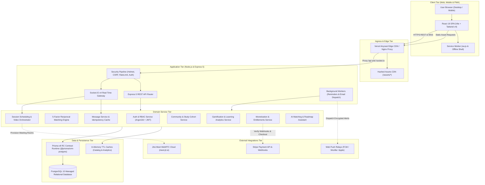
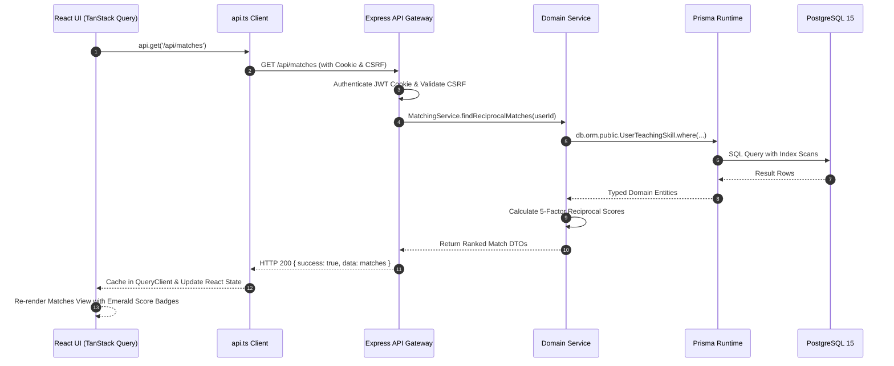
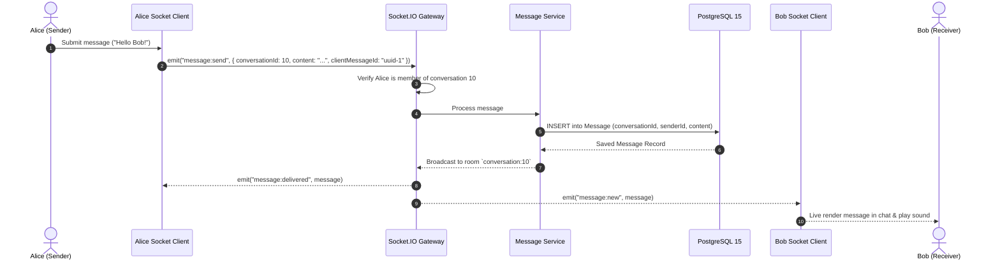
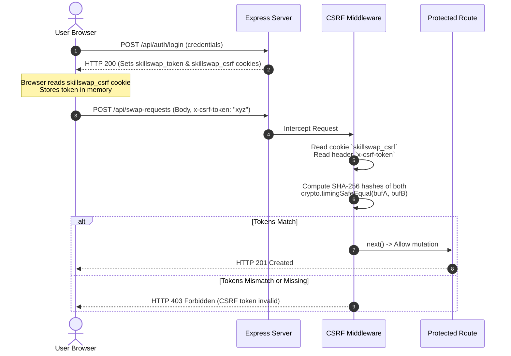
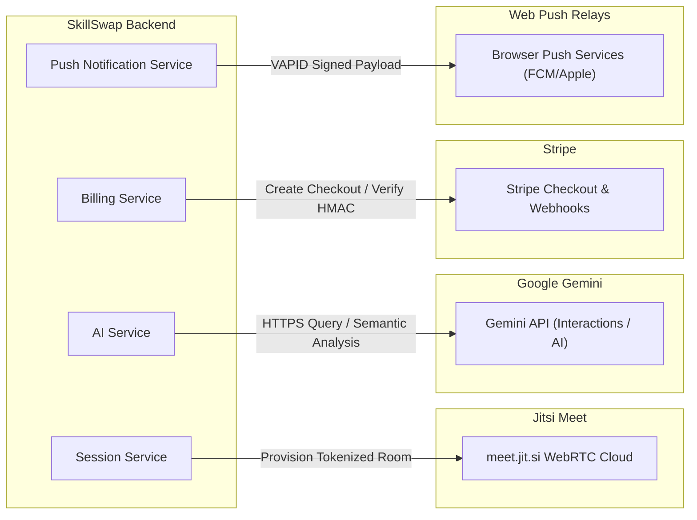
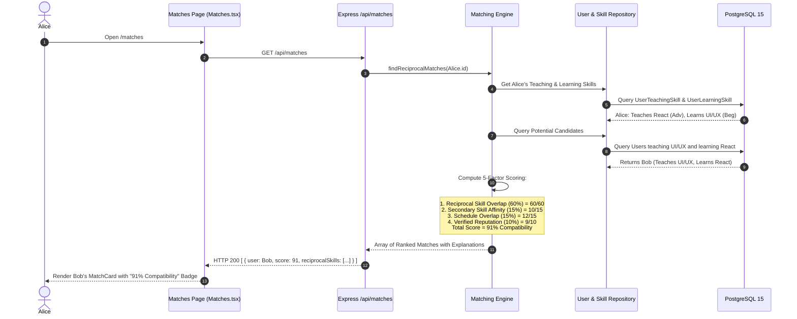
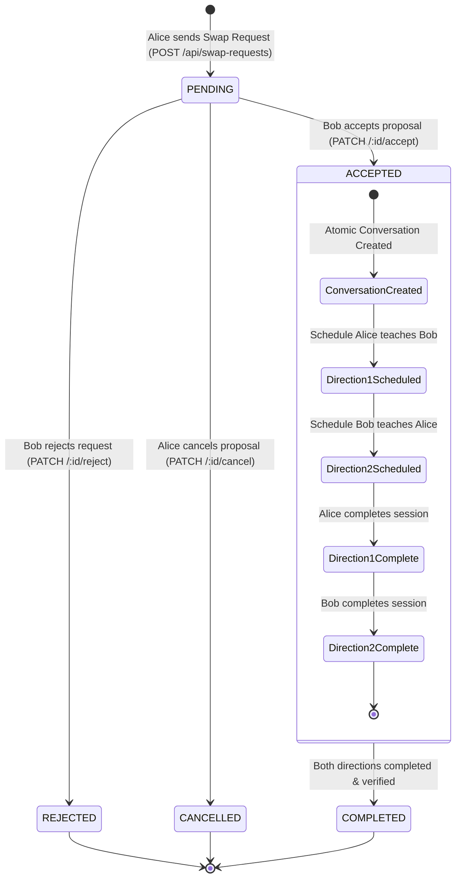
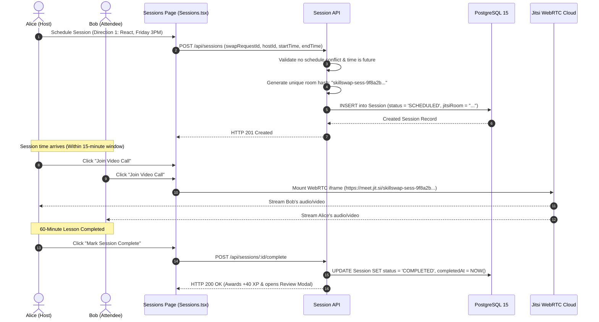
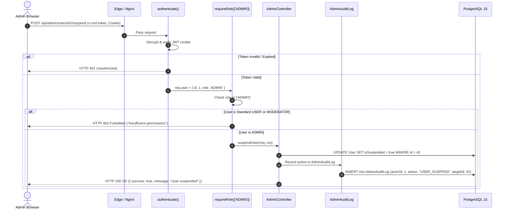
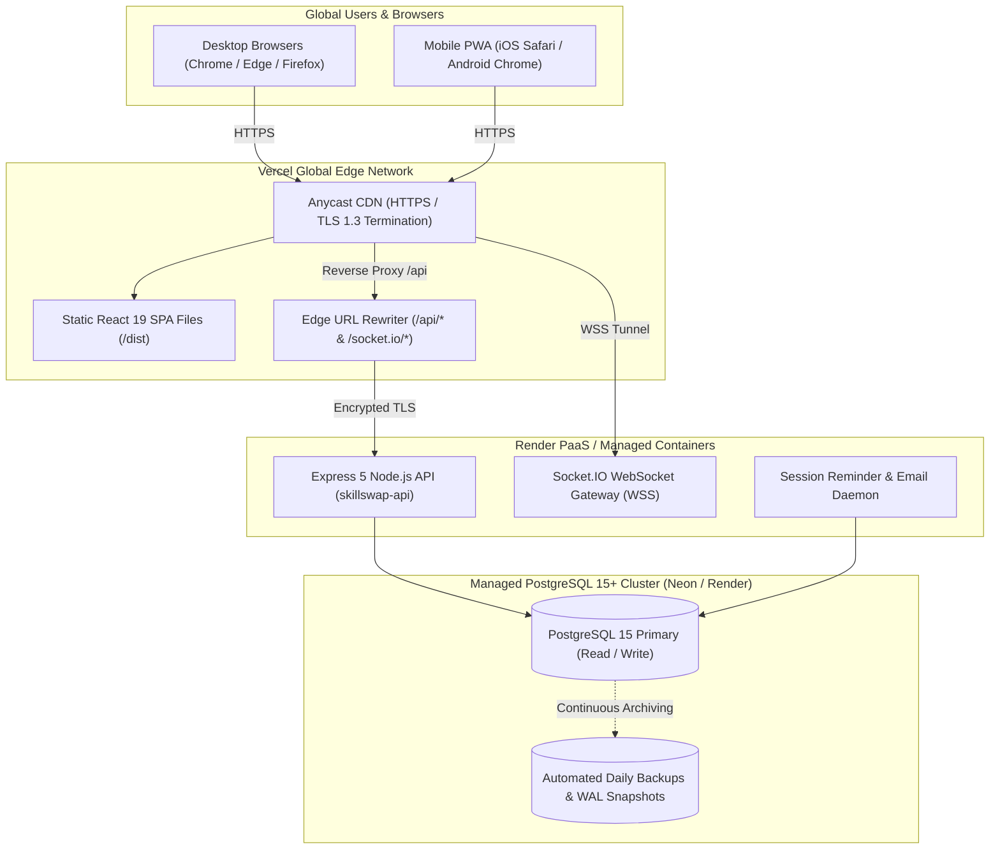

# SkillSwap — Complete System Architecture & Communication Blueprint

**Version:** 1.0.0 (Production Blueprint)  
**Target Environment:** React 19 Frontend + Express 5 Backend + PostgreSQL 15 Database + Prisma v8 RC  
**Author:** Principal Full-Stack Architect & Systems Engineer  
**Evaluation Date:** 2026-11-06  

---

## 1. High-Level Architecture Diagram

---

## 2. Core Communication Protocols & Subsystems

### 2.1 HTTP Request-Response Communication
- **Protocol:** RESTful JSON over HTTPS (HTTP/2 enabled at edge).
- **Client Transport:** [`client/src/lib/api.ts`](file:///e:/skillswap/client/src/lib/api.ts) wraps standard `fetch` with automatic header injection:
  - `Content-Type: application/json`
  - `Accept: application/json`
  - `x-csrf-token: <token>` (retrieved from `skillswap_csrf` cookie)
  - `credentials: 'include'` (ensuring HTTP-only cookies travel with all requests)
- **Response Normalization:** Server wraps all outcomes in standard JSON envelopes:
  - Success: `{ success: true, data: { ... }, pagination?: { ... } }`
  - Error: `{ success: false, error: { code, message, statusCode, details, timestamp, requestId } }`

---

### 2.2 Real-Time WebSocket Communication
- **Protocol:** WebSockets over WSS with HTTP long-polling fallback managed by Engine.IO v4.
- **Handshake Authentication:** During WebSocket connection handshake, Socket.IO extracts and verifies the signed JWT token from the `cookie` header. Unauthenticated socket connections are severed immediately with an `UnauthorizedError`.
- **Room Isolation:** Users join private rooms corresponding to authorized conversations (`conversation:${id}`) and study groups (`group:${id}`).
- **Idempotency & Deduplication:** Sockets accept a client-generated UUID (`clientMessageId`). An in-memory 15-second sliding window deduplicates messages to prevent accidental double-submits.

---

### 2.3 Authentication Cookies & Token Architecture
- **Stateless JWT Tokens:** Authentication state is encapsulated inside a cryptographically signed JSON Web Token (JWT).
- **Algorithm Pinning:** Pinned strictly to `HS256` to prevent algorithm confusion attacks (`none` or asymmetric public key spoofing).
- **Cookie Security Attributes:**
  - `httpOnly: true`: Completely inaccessible to client-side JavaScript (`document.cookie` returns empty), mitigating cross-site scripting (XSS) token theft.
  - `secure: true`: Enforced in production environments so tokens are only transmitted over TLS/HTTPS.
  - `sameSite: 'lax'`: Protects against cross-site request forgery while permitting normal top-level site navigation.
  - `path: '/'`: Scope covers the entire API domain.

---

### 2.4 CSRF Protection Architecture
- **Strategy:** Double-Submit Cookie Pattern with Cryptographic Timing-Attack Defense.
- **Token Generation:** Upon successful authentication, the server generates a cryptographically random token and sets it in a readable cookie named `skillswap_csrf`.
- **Request Enforcement:** Every state-mutating HTTP verb (`POST`, `PUT`, `PATCH`, `DELETE`) must transmit this token in the `x-csrf-token` HTTP header.
- **Constant-Time Verification:** [`csrf.middleware.ts`](file:///e:/skillswap/server/src/middleware/csrf.middleware.ts) compares the header token against the cookie token using `crypto.timingSafeEqual` over fixed-length SHA-256 byte buffers. This eliminates timing side-channel attacks.

---

### 2.5 Database Query Lifecycle & Prisma v8 RC Contract
1. **Contract Definition:** All schemas, models, relations, and indexes are defined in `server/src/prisma/contract.prisma`.
2. **Artifact Generation:** Running `npx prisma contract emit` compiles the schema into an abstract database AST (`contract.json`) and typed declaration file (`contract.d.ts`).
3. **Runtime Execution:** The database client is instantiated via `postgres<Contract>({ contractJson, url })`.
4. **Namespace Routing:** Queries execute via strongly-typed accessors:
   - ORM Query Lane: `db.orm.public.User.where(...)`
   - SQL Query Lane: `db.sql.public.User`
5. **Contract Verification:** Running `npx prisma db verify` compares the live PostgreSQL database marker (`prisma_contract.marker`) against the code contract, guaranteeing 100% agreement and zero schema drift.

---

### 2.6 External API Integrations

---

### 2.7 Background Processing & Scheduling Engine
- **Session Reminders:** A background worker loop in [`reminder.worker.ts`](file:///e:/skillswap/server/src/jobs/reminder.worker.ts) executes every 60 seconds, querying for upcoming sessions starting within 15 minutes. It dispatches transactional in-app notifications and Web Push alerts to participants.
- **Email Queue Worker:** Enqueued welcome and transactional notifications in `EmailQueue` are processed asynchronously with exponential retry backoff, ensuring email delivery delays never degrade HTTP response times.

---

### 2.8 File Upload Pipeline & Magic-Byte Validation
- **Storage Strategy:** Multi-user collaborative study group files are stored in `server/uploads/resources/` with randomized UUID filenames to prevent path traversal attacks.
- **Binary Magic-Byte Inspection:** Rather than trusting spoofable client MIME types or file extensions, [`groupResource.service.ts`](file:///e:/skillswap/server/src/services/groupResource.service.ts) inspects the raw file buffer's opening bytes:
  - PDF: `%PDF-` (`0x25 0x50 0x44 0x46 0x2D`)
  - PNG: `\x89PNG` (`0x89 0x50 0x4E 0x47`)
  - JPEG: `\xFF\xD8\xFF`
  - WebP: `RIFF...WEBP`
- **Binary Blocklist:** Executable markers (`MZ` for DOS/Windows PE, `\x7FELF` for Unix) are unconditionally rejected with HTTP 400 Bad Request.

---

### 2.9 Notification Delivery Architecture
- **In-App Real-Time Alerts:** Delivered instantly over active Socket.IO connections (`notification:new`), incrementing client notification bell counters.
- **Database Persistence:** Every alert is recorded in the `Notification` PostgreSQL table (`userId`, `type`, `title`, `message`, `link`, `isRead`).
- **Web Push Fallback:** If the user has subscribed to push notifications, the server signs a payload using RFC 8292 VAPID keys and dispatches it to the browser's native push service.

---

## 3. Detailed Sequence Diagrams

### 3.1 Reciprocal Matching Sequence

---

### 3.2 Swap Request Lifecycle State Machine

---

### 3.3 Session Scheduling & Embedded Jitsi Video

---

### 3.4 Administrator Role-Based Authorization Pipeline

---

### 3.5 Production Deployment Topology

