# SkillSwap — Complete End-to-End User Journey & Workflow Guide

**Version:** 1.0.0 (Production Blueprint)  
**Target Environment:** React 19 Frontend + Express 5 Backend + PostgreSQL 15 Database  
**Author:** Principal Full-Stack Architect & Technical Instructor  
**Evaluation Date:** 2026-11-06  

---

## 1. High-Level User Journey Flowchart

```mermaid
flowchart TD
    Start([New Visitor]) --> Step1[1. Landing Page /]
    Step1 --> Step2[2. Sign Up /register]
    Step2 --> Step3[3. Login /login]
    Step3 --> Step4[4. Auth Token & Cookie Set]
    Step4 --> Step5[5. Onboarding Wizard /onboarding]
    Step5 --> Step6[6. Profile Setup]
    Step6 --> Step7[7. Select Skills to Teach]
    Step7 --> Step8[8. Select Skills to Learn & Schedule]
    Step8 --> Step9[9. Dashboard /dashboard]
    
    Step9 --> Step10[10. User Discovery /discover]
    Step9 --> Step12[12. Reciprocal Matching /matches]
    Step10 --> Step11[11. Search & Filter Skills]
    Step11 --> Step13[13. View User Profile /profile/:username]
    Step12 --> Step13
    
    Step13 --> Step14[14. Send Swap Request]
    Step14 --> Step15[15. Receiver Gets Proposal /requests]
    Step15 --> Step16{16. Accept or Reject?}
    Step16 -- Reject --> EndReject([Proposal Closed])
    Step16 -- Accept --> Step17[17. Private Conversation Created]
    
    Step17 --> Step18[18. Real-Time Chat /messages]
    Step18 --> Step19[19. Schedule Reciprocal Sessions /sessions]
    Step19 --> Step20[20. Join Jitsi Video Room]
    Step20 --> Step21[21. Mutual Session Completion]
    Step21 --> Step22[22. Submit Verified Review]
    Step22 --> Step23[23. Notification & XP Awarded]
    
    Step23 --> Step24[24. Track Learning Analytics /learning-analytics]
    Step24 --> Step25[25. Unlock Achievements & Level Up]
    Step25 --> Step26[26. Join Community Forums /community]
    Step26 --> Step27[27. Create Posts, Q&A & Comments]
    Step27 --> Step28[28. Join Study Cohorts /community/groups]
    Step28 --> Step29[29. Multi-User Group Sessions]
    Step29 --> Step30[30. Share Notes & File Resources]
    Step30 --> Step31[31. Manage Subscriptions /pricing]
    Step31 --> Step32[32. AI Roadmaps & Scheduling /learning-roadmap]
    Step32 --> Step33[33. Update Account Settings /settings]
    Step33 --> Step34[34. Logout]
    Step34 --> Start
```

---

## 2. Comprehensive 34-Step User Journey Breakdown

---

### Step 1 — Landing Page
- **What User Sees:** High-converting landing page with Hero headline ("Exchange Skills, Grow Together"), feature highlights, popular skill badges (React, Python, UI/UX, Spanish), testimonials, and call-to-action buttons ("Get Started", "Sign In").
- **Action Performed:** Visitor browses the value proposition and clicks "Get Started".
- **React Component:** [`client/src/pages/Home.tsx`](file:///e:/skillswap/client/src/pages/Home.tsx) with [`Hero.tsx`](file:///e:/skillswap/client/src/components/landing/Hero.tsx), [`PopularSkills.tsx`](file:///e:/skillswap/client/src/components/landing/PopularSkills.tsx), and [`CTA.tsx`](file:///e:/skillswap/client/src/components/landing/CTA.tsx).
- **API Endpoint:** None (static pre-rendered shell with cached catalog stats).
- **Backend / Controller:** N/A.
- **PostgreSQL Tables:** None.
- **Response:** Renders client landing view.
- **What Happens Next:** User transitions to `/register`.
- **Restrictions:** Public access; logged-in users clicking "Get Started" are redirected to `/dashboard`.

---

### Step 2 — Sign Up (Registration)
- **What User Sees:** Registration form requesting full name, unique username, valid email, and secure password (minimum 8 characters).
- **Action Performed:** User fills in registration details and submits the form.
- **React Component:** [`client/src/pages/Register.tsx`](file:///e:/skillswap/client/src/pages/Register.tsx).
- **API Endpoint:** `POST /api/auth/register`
- **Backend / Controller:** `AuthController.register` in [`auth.controller.ts`](file:///e:/skillswap/server/src/controllers/auth.controller.ts) calling `AuthService.register`.
- **PostgreSQL Tables:** Reads `User` (uniqueness check on email and username); Inserts new row into `User` table (`isOnboarded = false`, `role = USER`); Enqueues welcome job into `EmailQueue`.
- **Response:** HTTP 201 Created with `{ success: true, user: { id, email, username, isOnboarded: false } }`.
- **What Happens Next:** Client sets auth state in Zustand store and redirects to `/onboarding`.
- **Errors / Restrictions:** Blocked if email/username already taken (409 Conflict); reserved usernames (`admin`, `root`, `skillswap`) blocked by blocklist validator (400 Bad Request).

---

### Step 3 — Login
- **What User Sees:** Login modal/form requesting email and password with "Remember me" option and "Forgot password?" recovery link.
- **Action Performed:** Existing user enters credentials and clicks "Log In".
- **React Component:** [`client/src/pages/Login.tsx`](file:///e:/skillswap/client/src/pages/Login.tsx).
- **API Endpoint:** `POST /api/auth/login`
- **Backend / Controller:** `AuthController.login` calling `AuthService.login`.
- **PostgreSQL Tables:** Reads `User` where `email = :email`; verifies password hash via `argon2.verify()`.
- **Response:** HTTP 200 OK with `{ success: true, user: { id, email, username, isOnboarded, role } }`.
- **What Happens Next:** Two HTTP-only cookies are attached: `skillswap_token` (JWT access token) and `skillswap_csrf` (CSRF token).
- **Errors / Restrictions:** Invalid credentials return generic 401 Unauthorized; rate limiter blocks IP after 15 failed attempts in 15 minutes. Deactivated users (`isDeactivated: true`) receive 403 Forbidden.

---

### Step 4 — Authentication & Session Creation
- **What User Sees:** Transparent authorization layer. AppHeader updates from "Sign In" to user avatar, username, and interactive `NotificationBell`.
- **Action Performed:** Browser automatically stores HTTP-only cookies and sends them with subsequent requests.
- **React Component:** [`client/src/store/authStore.ts`](file:///e:/skillswap/client/src/store/authStore.ts) and [`client/src/lib/api.ts`](file:///e:/skillswap/client/src/lib/api.ts).
- **API Endpoint:** `GET /api/auth/me` (called on application boot).
- **Backend / Controller:** `AuthController.me` wrapped with `authenticate` middleware in [`auth.middleware.ts`](file:///e:/skillswap/server/src/middleware/auth.middleware.ts).
- **PostgreSQL Tables:** Reads `User` by decoded JWT `userId`.
- **Response:** HTTP 200 OK with current authenticated user profile.
- **What Happens Next:** If `isOnboarded: false`, router forces `/onboarding`. If `isOnboarded: true`, router permits `/dashboard`.
- **Errors / Restrictions:** Expired or malformed JWT returns 401; user must re-authenticate.

---

### Step 5 — Onboarding Wizard
- **What User Sees:** 4-step interactive wizard with a progress indicator: (1) Profile, (2) Skills You Teach, (3) Skills You Want to Learn, (4) Weekly Availability.
- **Action Performed:** User steps through each section sequentially.
- **React Component:** [`client/src/pages/Onboarding.tsx`](file:///e:/skillswap/client/src/pages/Onboarding.tsx).
- **API Endpoint:** `GET /api/skills` (fetches 35-skill catalog categorized into Development, Design, etc.).
- **Backend / Controller:** `SkillController.getAllSkills` via `SkillRepository.findAll`.
- **PostgreSQL Tables:** Reads `Skill` table (cached in memory via `skillRepository`).
- **Response:** HTTP 200 OK with array of 35 catalog skills.
- **What Happens Next:** User moves to Step 6.
- **Errors / Restrictions:** Route guard `<ProtectedRoute>` blocks navigation away from `/onboarding` until completed.

---

### Step 6 — Profile Setup
- **What User Sees:** Inputs for professional bio ("Full-stack dev exploring UI/UX"), geographic location ("San Francisco, CA"), and profile avatar image selector.
- **Action Performed:** User fills in bio and location.
- **React Component:** `Onboarding.tsx` (Step 1).
- **API Endpoint:** Ephemeral state held in React state until atomic submission.
- **Backend / Controller:** N/A (buffered in client).
- **PostgreSQL Tables:** None yet.
- **Response:** Validates client form fields (bio max 500 chars).
- **What Happens Next:** User advances to Step 7.
- **Errors / Restrictions:** Bio must not exceed 500 characters.

---

### Step 7 — Selecting Skills to Teach
- **What User Sees:** Searchable skill tag selector. User selects 1 to 5 skills they are competent to teach (e.g., "React", "TypeScript", "Node.js").
- **Action Performed:** User clicks skill badges; selected skills turn emerald green.
- **React Component:** [`client/src/components/onboarding/TeachSkillsStep.tsx`](file:///e:/skillswap/client/src/components/onboarding/TeachSkillsStep.tsx).
- **API Endpoint:** None (buffered in React state).
- **Backend / Controller:** N/A.
- **PostgreSQL Tables:** None yet.
- **Response:** Client state updated with `teachingSkills: [1, 4, 12]`.
- **What Happens Next:** User advances to Step 8.
- **Errors / Restrictions:** User must select at least 1 teaching skill.

---

### Step 8 — Selecting Skills to Learn & Submitting Onboarding
- **What User Sees:** Skill tag selector for learning goals (e.g., "UI/UX Design", "Figma") followed by a weekly calendar grid to mark available days and hours.
- **Action Performed:** User marks skills and timeslots, then clicks "Complete Onboarding".
- **React Component:** [`client/src/components/onboarding/LearnSkillsStep.tsx`](file:///e:/skillswap/client/src/components/onboarding/LearnSkillsStep.tsx) and [`AvailabilityStep.tsx`](file:///e:/skillswap/client/src/components/onboarding/AvailabilityStep.tsx).
- **API Endpoint:** `POST /api/onboarding`
- **Backend / Controller:** `OnboardingController.submitOnboarding` calling `OnboardingService.completeOnboarding` in [`onboarding.service.ts`](file:///e:/skillswap/server/src/services/onboarding.service.ts).
- **PostgreSQL Tables:** Executed inside an atomic transaction:
  1. Inserts into `UserTeachingSkill` (for each teaching skill ID).
  2. Inserts into `UserLearningSkill` (for each learning skill ID).
  3. Inserts into `UserAvailability` (for each selected day/time slot).
  4. Updates `User` setting `bio`, `location`, and `isOnboarded = true`.
  5. Inserts default row into `UserXP` (`totalXP = 0`, `currentLevel = 1`).
- **Response:** HTTP 200 OK with `{ success: true, user: { isOnboarded: true } }`.
- **What Happens Next:** Client redirects to `/dashboard`.
- **Errors / Restrictions:** Overlapping teaching and learning skills are rejected; at least 1 learning skill and 1 availability slot required.

---

### Step 9 — Dashboard
- **What User Sees:** Aggregated statistics cards (Active Swaps, Upcoming Sessions, Unread Messages, Completed Sessions), Reciprocal Match Recommendations banner, Upcoming Sessions timeline, Profile Completion percentage bar (100%), and Live Activity Stream.
- **Action Performed:** User reviews their learning hub and chooses to explore matches or messages.
- **React Component:** [`client/src/pages/Dashboard.tsx`](file:///e:/skillswap/client/src/pages/Dashboard.tsx).
- **API Endpoint:** `GET /api/dashboard`
- **Backend / Controller:** `DashboardController.getDashboard` calling `DashboardService.getSummary` in [`dashboard.service.ts`](file:///e:/skillswap/server/src/services/dashboard.service.ts).
- **PostgreSQL Tables:** Reads `SwapRequest` (count where status = ACCEPTED), `Session` (count where status = SCHEDULED), `Message` (count unread where receiverId = userId), and `User` (profile completeness weight).
- **Response:** HTTP 200 OK with `{ stats, upcomingSessions, recentActivity, profileCompletion }`.
- **What Happens Next:** User clicks "Find Matches" in navigation.
- **Errors / Restrictions:** Unauthenticated request returns 401; un-onboarded user redirected to `/onboarding`.

---

### Step 10 — Discovering Other Users
- **What User Sees:** Grid of user cards showing member names, avatars, locations, teaching skill badges, learning skill badges, star ratings, and review counts.
- **Action Performed:** User browses members in the community.
- **React Component:** [`client/src/pages/Discover.tsx`](file:///e:/skillswap/client/src/pages/Discover.tsx) and [`UserCard.tsx`](file:///e:/skillswap/client/src/components/discover/UserCard.tsx).
- **API Endpoint:** `GET /api/users?page=1&limit=20`
- **Backend / Controller:** `UserController.getUsers` calling `UserRepository.findUsers`.
- **PostgreSQL Tables:** Reads `User` table joined with `UserTeachingSkill`, `UserLearningSkill`, and `Skill`, filtering `isOnboarded = true`, `isActive = true`, `isSuspended = false`.
- **Response:** Paginated list of users with pagination metadata (`page, limit, total, totalPages`).
- **What Happens Next:** User applies search filter.
- **Errors / Restrictions:** Current logged-in user is automatically excluded from the directory.

---

### Step 11 — Searching and Filtering Skills
- **What User Sees:** Search bar with live keyword filtering and category filter pills ("Development", "Design", "Languages").
- **Action Performed:** User types "Figma" or clicks "Design" pill.
- **React Component:** [`client/src/pages/Discover.tsx`](file:///e:/skillswap/client/src/pages/Discover.tsx).
- **API Endpoint:** `GET /api/users?search=Figma&category=Design`
- **Backend / Controller:** `UserController.getUsers` with search query parameters.
- **PostgreSQL Tables:** PostgreSQL database query with `ILIKE` on `User.name`, `User.location`, and related `Skill.name`.
- **Response:** Filtered array of matching user cards.
- **What Happens Next:** User navigates to reciprocal matches.
- **Errors / Restrictions:** Invalid categories return empty array; search input sanitized against SQL injection.

---

### Step 12 — Reciprocal Matching
- **What User Sees:** Recommended learning partners sorted by reciprocal compatibility percentage (e.g., "94% Match — Alice teaches React which Bob wants to learn, and Bob teaches UI/UX which Alice wants to learn").
- **Action Performed:** User reviews explainable match reasons.
- **React Component:** [`client/src/pages/Matches.tsx`](file:///e:/skillswap/client/src/pages/Matches.tsx) and [`MatchCard.tsx`](file:///e:/skillswap/client/src/components/matches/MatchCard.tsx).
- **API Endpoint:** `GET /api/matches`
- **Backend / Controller:** `MatchingController.getMatches` calling `MatchingService.findReciprocalMatches` in [`matching.service.ts`](file:///e:/skillswap/server/src/services/matching.service.ts).
- **PostgreSQL Tables:** Reads current user's `UserTeachingSkill` and `UserLearningSkill`; queries candidate users possessing inverse combinations; reads `UserAvailability` for schedule intersection.
- **Response:** HTTP 200 OK with array of matched user objects including `compatibilityScore` (0–100), `reciprocalSkills`, `secondarySkills`, and `scheduleOverlapScore`.
- **What Happens Next:** User clicks on Bob's card to view profile.
- **Errors / Restrictions:** Users with zero reciprocal skill overlap are filtered out; one-way matches are capped at 30%.

---

### Step 13 — Viewing Another User's Profile
- **What User Sees:** Public profile page for Bob showing bio, location, teaching skills with proficiency, learning skills, schedule availability grid, and verified review testimonials with star ratings.
- **Action Performed:** User inspects credentials and clicks "Send Swap Request".
- **React Component:** [`client/src/pages/Profile.tsx`](file:///e:/skillswap/client/src/pages/Profile.tsx) and [`ReputationSummary.tsx`](file:///e:/skillswap/client/src/components/reviews/ReputationSummary.tsx).
- **API Endpoint:** `GET /api/users/:username` and `GET /api/reviews/user/:userId`
- **Backend / Controller:** `UserController.getUserByUsername` and `ReviewController.getUserReviews`.
- **PostgreSQL Tables:** Reads `User`, `UserTeachingSkill`, `UserLearningSkill`, `UserAvailability`, and `Review` (joined with reviewer User).
- **Response:** Detailed user profile and list of verified reviews.
- **What Happens Next:** Opens `SwapRequestModal`.
- **Errors / Restrictions:** Sensitive data (passwords, email addresses, reset tokens) is strictly redacted.

---

### Step 14 — Sending a Swap Request
- **What User Sees:** Modal prompting Alice to select: (1) Which skill she will teach Bob (e.g., "React"), (2) Which skill Bob will teach her (e.g., "UI/UX Design"), and (3) An introductory message.
- **Action Performed:** Alice selects skills, types message, and clicks "Send Proposal".
- **React Component:** [`client/src/components/requests/SwapRequestModal.tsx`](file:///e:/skillswap/client/src/components/requests/SwapRequestModal.tsx).
- **API Endpoint:** `POST /api/swap-requests`
- **Backend / Controller:** `SwapRequestController.createRequest` calling `SwapRequestService.createRequest` in [`swapRequest.service.ts`](file:///e:/skillswap/server/src/services/swapRequest.service.ts).
- **PostgreSQL Tables:** 
  1. Validates reciprocal skill alignment in DB.
  2. Inserts into `SwapRequest` (`senderId = Alice`, `receiverId = Bob`, `status = PENDING`).
  3. Inserts into `Notification` for Bob (`type = SWAP_PROPOSAL`).
- **Response:** HTTP 201 Created with `{ success: true, swapRequest: { id, status: "PENDING" } }`.
- **What Happens Next:** Real-time Socket.IO alert dispatched to Bob; Alice sees proposal in "Outgoing Requests".
- **Errors / Restrictions:** Blocked if active request already exists (409 Conflict); blocked if skills are not reciprocal (400 Bad Request); Free tier quota blocks if user already has 3 pending proposals (403 Forbidden).

---

### Step 15 — Receiving a Swap Request
- **What User Sees:** Real-time toast alert pops up on Bob's screen; notification badge counter increments to "1"; proposal card appears under Bob's `/requests` "Incoming" tab.
- **Action Performed:** Bob navigates to `/requests` to inspect Alice's proposal.
- **React Component:** [`client/src/pages/Requests.tsx`](file:///e:/skillswap/client/src/pages/Requests.tsx) and [`RequestCard.tsx`](file:///e:/skillswap/client/src/components/requests/RequestCard.tsx).
- **API Endpoint:** `GET /api/swap-requests/incoming`
- **Backend / Controller:** `SwapRequestController.getIncomingRequests` via `SwapRequestRepository`.
- **PostgreSQL Tables:** Reads `SwapRequest` where `receiverId = Bob.id` and `status = PENDING`, joined with sender profile and skill names.
- **Response:** HTTP 200 OK with array of pending incoming swap requests.
- **What Happens Next:** Bob decides to accept or reject.
- **Errors / Restrictions:** Only the designated receiver can view incoming requests.

---

### Step 16 — Accepting or Rejecting a Swap Request
- **What User Sees:** "Accept" and "Decline" buttons on the request card.
- **Action Performed:** Bob clicks "Accept Swap".
- **React Component:** [`client/src/components/requests/RequestCard.tsx`](file:///e:/skillswap/client/src/components/requests/RequestCard.tsx).
- **API Endpoint:** `PATCH /api/swap-requests/:id/accept` (or `/reject`)
- **Backend / Controller:** `SwapRequestController.acceptRequest` in `swapRequest.service.ts`.
- **PostgreSQL Tables:** Executed inside an atomic transaction:
  1. Updates `SwapRequest` setting `status = ACCEPTED`.
  2. Inserts into `Conversation` (`title = "Alice & Bob Swap"`).
  3. Inserts two rows into `ConversationParticipant` (linking Alice and Bob).
  4. Inserts into `Notification` for Alice (`type = SWAP_ACCEPTED`).
- **Response:** HTTP 200 OK with `{ success: true, conversationId: 42 }`.
- **What Happens Next:** Real-time event `swap:accepted` delivered via WebSocket; "Start Chat" button appears.
- **Errors / Restrictions:** Cannot accept an already accepted, rejected, or cancelled request (409 Conflict).

---

### Step 17 — Creating a Conversation
- **What User Sees:** A private conversation entry appears in the conversation drawer on `/messages`.
- **Action Performed:** User clicks on the conversation to open chat.
- **React Component:** [`client/src/pages/Messages.tsx`](file:///e:/skillswap/client/src/pages/Messages.tsx) and [`ConversationItem.tsx`](file:///e:/skillswap/client/src/components/messages/ConversationItem.tsx).
- **API Endpoint:** `GET /api/conversations` and `GET /api/conversations/:id/messages`
- **Backend / Controller:** `ConversationController.getConversations` and `getMessages` in [`conversation.controller.ts`](file:///e:/skillswap/server/src/controllers/conversation.controller.ts).
- **PostgreSQL Tables:** Reads `Conversation` joined with `ConversationParticipant` and latest `Message`.
- **Response:** HTTP 200 OK with conversation metadata and initial message history.
- **What Happens Next:** Sockets join room `conversation:42`.
- **Errors / Restrictions:** Non-participants receive 403 Forbidden.

---

### Step 18 — Real-Time Messaging
- **What User Sees:** Chat window with message bubbles, timestamp, delivery ticks, and typing indicators ("Alice is typing...").
- **Action Performed:** Alice types "Hi Bob, excited to start!" and presses Enter.
- **React Component:** [`client/src/components/messages/ChatWindow.tsx`](file:///e:/skillswap/client/src/components/messages/ChatWindow.tsx) and [`MessageInput.tsx`](file:///e:/skillswap/client/src/components/messages/MessageInput.tsx).
- **API Endpoint / WebSocket:** Emits `message:send` with `{ conversationId: 42, content: "...", clientMessageId: "uuid-123" }`.
- **Backend / Controller:** `socket/index.ts` calling `MessageService.sendMessage`.
- **PostgreSQL Tables:** Checks deduplication cache; inserts into `Message` (`conversationId = 42`, `senderId = Alice`, `content = "..."`); updates `Conversation.updatedAt`.
- **Response:** Sockets broadcast `message:new` to room `conversation:42`.
- **What Happens Next:** Bob's screen renders message instantly without page refresh; audio chime plays.
- **Errors / Restrictions:** Duplicate `clientMessageId` within 15 seconds returns existing message without duplicate row.

---

### Step 19 — Scheduling a Learning Session
- **What User Sees:** "Schedule Session" modal with date picker, time slot selector, and session direction toggle:
  - Direction 1: Alice teaches Bob (React)
  - Direction 2: Bob teaches Alice (UI/UX)
- **Action Performed:** Alice schedules Direction 1 for Friday at 3:00 PM.
- **React Component:** [`client/src/components/sessions/ScheduleSessionModal.tsx`](file:///e:/skillswap/client/src/components/sessions/ScheduleSessionModal.tsx).
- **API Endpoint:** `POST /api/sessions`
- **Backend / Controller:** `SessionController.scheduleSession` calling `SessionService.createSession` in [`session.service.ts`](file:///e:/skillswap/server/src/services/session.service.ts).
- **PostgreSQL Tables:** Validates time is in future; inserts into `Session` (`swapRequestId`, `hostId = Alice`, `attendeeId = Bob`, `startTime`, `endTime`, `status = SCHEDULED`, `jitsiRoom = "skillswap-..."`).
- **Response:** HTTP 201 Created with scheduled session record.
- **What Happens Next:** Session appears under `/sessions` tab with countdown timer.
- **Errors / Restrictions:** Past start time or conflicting overlapping session returns 400 Bad Request.

---

### Step 20 — Joining a Jitsi Video Meeting
- **What User Sees:** When session is 10 minutes from starting, the "Join Video" button turns emerald green. Clicking opens an embedded Jitsi Meet modal.
- **Action Performed:** Both users click "Join Video Call".
- **React Component:** [`client/src/components/sessions/VideoMeetingModal.tsx`](file:///e:/skillswap/client/src/components/sessions/VideoMeetingModal.tsx).
- **API Endpoint:** Jitsi WebRTC iframe generated via tokenized room URL (`https://meet.jit.si/skillswap-<hash>`).
- **Backend / Controller:** Validates user is host or attendee of session.
- **PostgreSQL Tables:** Reads `Session` by ID.
- **Response:** Embedded WebRTC video meeting loads with camera, microphone, screen sharing, and in-meeting text chat.
- **What Happens Next:** Users conduct the 60-minute skill exchange lesson.
- **Errors / Restrictions:** Users cannot join earlier than 15 minutes before scheduled start time.

---

### Step 21 — Completing the Session
- **What User Sees:** "Mark Session Complete" button appears after session has started.
- **Action Performed:** Alice marks session complete; Bob receives a prompt to confirm completion.
- **React Component:** [`client/src/components/sessions/SessionCard.tsx`](file:///e:/skillswap/client/src/components/sessions/SessionCard.tsx).
- **API Endpoint:** `POST /api/sessions/:id/complete`
- **Backend / Controller:** `SessionController.completeSession` calling `SessionService.completeSession`.
- **PostgreSQL Tables:** Updates `Session` setting `status = COMPLETED`, `completedAt = NOW()`; updates `SwapRequest` status if both reciprocal directions are completed.
- **Response:** HTTP 200 OK with `{ success: true, status: "COMPLETED" }`.
- **What Happens Next:** Automated review modal opens; +40 XP awarded to both users.
- **Errors / Restrictions:** Cannot complete before session scheduled start time minus 15 minutes.

---

### Step 22 — Submitting Reviews
- **What User Sees:** Review modal asking for a 1–5 star rating, feedback tags ("Clear explanations", "Punctual", "Patient"), and a written testimonial.
- **Action Performed:** Bob rates Alice 5 stars: "Alice is an amazing React teacher!" and submits.
- **React Component:** [`client/src/components/reviews/ReviewModal.tsx`](file:///e:/skillswap/client/src/components/reviews/ReviewModal.tsx) and [`RatingStars.tsx`](file:///e:/skillswap/client/src/components/reviews/RatingStars.tsx).
- **API Endpoint:** `POST /api/reviews`
- **Backend / Controller:** `ReviewController.createReview` calling `ReviewService.submitReview` in [`review.service.ts`](file:///e:/skillswap/server/src/services/review.service.ts).
- **PostgreSQL Tables:** 
  1. Validates session is `COMPLETED`.
  2. Inserts into `Review` (`sessionId`, `reviewerId = Bob`, `revieweeId = Alice`, `rating = 5`, `comment = "..."`).
  3. Recalculates `User` reputation: `averageRating`, `totalReviews = totalReviews + 1`, `completedTeachingSessions = completedTeachingSessions + 1`.
- **Response:** HTTP 201 Created with saved review.
- **What Happens Next:** Review appears on Alice's public profile.
- **Errors / Restrictions:** Duplicate review for the same session is rejected with 409 Conflict; non-participants rejected with 403.

---

### Step 23 — Receiving Notifications
- **What User Sees:** Real-time toast alert: "Bob left you a 5-star review!"; notification bell rings; notification dropdown updates.
- **Action Performed:** Alice clicks the notification to mark it as read.
- **React Component:** [`client/src/components/notifications/NotificationBell.tsx`](file:///e:/skillswap/client/src/components/notifications/NotificationBell.tsx).
- **API Endpoint:** `PATCH /api/notifications/:id/read`
- **Backend / Controller:** `NotificationController.markAsRead`.
- **PostgreSQL Tables:** Updates `Notification` setting `isRead = true`.
- **Response:** HTTP 200 OK.
- **What Happens Next:** Unread badge counter decrements.
- **Errors / Restrictions:** Users can only mark their own notifications as read.

---

### Step 24 — Tracking Learning Progress
- **What User Sees:** Learning analytics page (`/learning-analytics`) displaying total learning hours, completed sessions, skill distribution chart, and GitHub-style 365-day activity heatmap.
- **Action Performed:** User toggles time filters ("Last 7 Days", "Last 30 Days", "All Time").
- **React Component:** [`client/src/pages/LearningAnalytics.tsx`](file:///e:/skillswap/client/src/pages/LearningAnalytics.tsx) and [`ActivityHeatmap.tsx`](file:///e:/skillswap/client/src/components/gamification/ActivityHeatmap.tsx).
- **API Endpoint:** `GET /api/gamification/summary` and `GET /api/gamification/activity-calendar`
- **Backend / Controller:** `GamificationController.getSummary` and `getActivityCalendar` in [`gamification.controller.ts`](file:///e:/skillswap/server/src/controllers/gamification.controller.ts).
- **PostgreSQL Tables:** Reads `UserXP`, `XPTransaction` (aggregated by date), `Session` (completed duration), and `UserTeachingSkill`.
- **Response:** HTTP 200 OK with analytics metrics and SVG heatmap matrix data.
- **What Happens Next:** User reviews their earned achievements.
- **Errors / Restrictions:** Private statistics are shielded behind user authentication.

---

### Step 25 — Earning XP and Achievements
- **What User Sees:** Badge unlock modal: "Achievement Unlocked: FIRST_SWAP (Completed your first skill swap!)" with celebratory animation and +50 XP bonus.
- **Action Performed:** User pins badge to their public profile showcase.
- **React Component:** [`client/src/components/gamification/BadgeShowcase.tsx`](file:///e:/skillswap/client/src/components/gamification/BadgeShowcase.tsx).
- **API Endpoint:** `GET /api/gamification/achievements`
- **Backend / Controller:** `GamificationController.getAchievements` via `GamificationService`.
- **PostgreSQL Tables:** Reads `Achievement` catalog and joins `UserAchievement` where `userId = :userId`.
- **Response:** HTTP 200 OK with list of unlocked and locked badges with progress requirements.
- **What Happens Next:** User level advances (e.g., Level 1: Novice Explorer → Level 2: Skill Apprentice).
- **Errors / Restrictions:** Achievements cannot be unlocked multiple times (idempotent award logic).

---

### Step 26 — Joining Communities
- **What User Sees:** Community discussion forum (`/community`) with categories ("Web Development", "UI/UX Design", "Mobile", "DevOps") and trending post feed.
- **Action Performed:** User selects "Web Development" category and views recent questions.
- **React Component:** [`client/src/pages/Community.tsx`](file:///e:/skillswap/client/src/pages/Community.tsx).
- **API Endpoint:** `GET /api/community/posts?category=Web+Development`
- **Backend / Controller:** `CommunityController.getPosts` calling `CommunityService.getPosts` in [`community.service.ts`](file:///e:/skillswap/server/src/services/community.service.ts).
- **PostgreSQL Tables:** Reads `CommunityPost` joined with author `User`, filtered by category, ordered by `createdAt DESC`.
- **Response:** HTTP 200 OK with paginated list of posts with upvote counts and comment counts.
- **What Happens Next:** User clicks "New Post".
- **Errors / Restrictions:** Private group posts are never exposed in public community feeds.

---

### Step 27 — Creating Posts, Q&A & Comments
- **What User Sees:** Post creation modal with title, post type selector (`DISCUSSION`, `QUESTION`, `RESOURCE`), skill tag selector, and Markdown editor.
- **Action Performed:** User posts a question: "How to handle Tailwind v4 container queries?". Another user answers, and the question author clicks "Accept as Solution".
- **React Component:** [`client/src/pages/CommunityPostDetail.tsx`](file:///e:/skillswap/client/src/pages/CommunityPostDetail.tsx).
- **API Endpoint:** `POST /api/community/posts`, `POST /api/community/posts/:id/comments`, `POST /api/community/comments/:id/accept`
- **Backend / Controller:** `CommunityController.createPost`, `createComment`, `acceptAnswer`.
- **PostgreSQL Tables:** Inserts into `CommunityPost` and `PostComment`; updates `PostComment.isAccepted = true`; awards +25 XP to answer author via `XPTransaction`.
- **Response:** HTTP 201 Created; accepted comment highlighted with green badge.
- **What Happens Next:** Users upvote helpful comments via `POST /api/community/vote`.
- **Errors / Restrictions:** Only the question author can accept an answer; voting is composite-unique (`userId + postId` or `userId + commentId`).

---

### Step 28 — Joining Study Groups
- **What User Sees:** Study groups directory (`/community/groups`) displaying public and private study cohorts (e.g., "Full-Stack TypeScript Study Cohort", "Design Systems Guild").
- **Action Performed:** User clicks "Join Group" on a public group or "Request to Join" on a private group.
- **React Component:** [`client/src/pages/StudyGroups.tsx`](file:///e:/skillswap/client/src/pages/StudyGroups.tsx) and [`StudyGroupDetail.tsx`](file:///e:/skillswap/client/src/pages/StudyGroupDetail.tsx).
- **API Endpoint:** `POST /api/community/groups/:id/join`
- **Backend / Controller:** `CommunityController.joinGroup`.
- **PostgreSQL Tables:** Inserts into `StudyGroupMember` (`groupId`, `userId`, `role = MEMBER`, `status = ACTIVE` for public or `PENDING` for private).
- **Response:** HTTP 200 OK with membership status.
- **What Happens Next:** For public groups, user immediately gains access to collaborative tabs.
- **Errors / Restrictions:** Private group membership requires group owner/moderator approval before content can be viewed.

---

### Step 29 — Participating in Group Sessions
- **What User Sees:** "Group Sessions" tab inside study group showing upcoming live cohort sessions with host name, topic, scheduled time, and remaining capacity seats (e.g., "8 / 10 seats filled").
- **Action Performed:** User clicks "Register for Session".
- **React Component:** [`client/src/components/collaboration/GroupSessionsTab.tsx`](file:///e:/skillswap/client/src/components/collaboration/GroupSessionsTab.tsx).
- **API Endpoint:** `POST /api/community/groups/:id/sessions/:sessionId/register`
- **Backend / Controller:** `GroupSessionController.registerForSession` in [`groupSession.controller.ts`](file:///e:/skillswap/server/src/controllers/groupSession.controller.ts).
- **PostgreSQL Tables:** Inserts into `GroupSessionAttendee` (`sessionId`, `userId`, `status = REGISTERED` or `WAITLIST` if session capacity reached).
- **Response:** HTTP 201 Created with registration status.
- **What Happens Next:** At meeting time, registered participants join Jitsi video; host verifies attendance.
- **Errors / Restrictions:** If full, user placed on waitlist; if a registered user cancels, waitlisted user is automatically promoted to registered.

---

### Step 30 — Sharing Learning Resources
- **What User Sees:** "Resources" tab with shared notes and downloadable files (PDF cheat sheets, code snippets, diagrams) uploaded by cohort peers.
- **Action Performed:** User uploads a PDF guide: "Docker-Microservices-Cheatsheet.pdf".
- **React Component:** [`client/src/components/collaboration/GroupResourcesTab.tsx`](file:///e:/skillswap/client/src/components/collaboration/GroupResourcesTab.tsx).
- **API Endpoint:** `POST /api/community/groups/:id/resources` and `GET /.../resources/:resId/download`
- **Backend / Controller:** `GroupResourceController.createResource` and `downloadResource` in [`groupResource.controller.ts`](file:///e:/skillswap/server/src/controllers/groupResource.controller.ts).
- **PostgreSQL Tables:** Inserts into `GroupResource` (`groupId`, `uploaderId`, `title`, `type = FILE`, `fileUrl`); verifies membership before downloading.
- **Response:** HTTP 201 Created.
- **What Happens Next:** Resource appears in group library with download button.
- **Errors / Restrictions:** Binary magic-byte inspection verifies genuine file types (`%PDF-`, `\x89PNG`, `\xff\xd8\xff`, `RIFF...WEBP`); executable binaries (`MZ`, `ELF`) rejected with 400 Bad Request; non-members receive 403 Forbidden on download.

---

### Step 31 — Managing Subscription Plans
- **What User Sees:** Pricing page (`/pricing`) comparing FREE (3 active swaps, standard matching), PRO (unlimited swaps, AI recommendations, priority matching), and PREMIUM (custom study groups, 1-on-1 mentorship analytics).
- **Action Performed:** User clicks "Upgrade to Pro".
- **React Component:** [`client/src/pages/Pricing.tsx`](file:///e:/skillswap/client/src/pages/Pricing.tsx) and [`BillingSettings.tsx`](file:///e:/skillswap/client/src/pages/BillingSettings.tsx).
- **API Endpoint:** `POST /api/billing/checkout`
- **Backend / Controller:** `BillingController.createCheckout` calling `BillingService.createCheckoutSession` in [`billing.service.ts`](file:///e:/skillswap/server/src/services/billing/billing.service.ts).
- **PostgreSQL Tables:** Reads `SubscriptionPlan`; creates pending `UserSubscription` record; returns checkout redirect URL (or mock activation in sandbox mode).
- **Response:** HTTP 201 Created with `{ checkoutUrl: "..." }`.
- **What Happens Next:** Webhook `checkout.session.completed` transitions tier to PRO; invoices recorded in `Invoice` table.
- **Errors / Restrictions:** Cannot purchase FREE tier; webhook signatures verified with HMAC secrets; duplicate webhooks suppressed idempotently.

---

### Step 32 — Using AI Recommendations & Roadmaps
- **What User Sees:** Personalized 4-stage learning roadmap page (`/learning-roadmap`) tailored to user's learning goals (e.g., "Full-Stack React Roadmap: (1) Fundamentals, (2) State Management, (3) Server Components, (4) Production Deployment").
- **Action Performed:** User checks off a milestone and asks the AI Learning Assistant for preparation tips.
- **React Component:** [`client/src/pages/LearningRoadmap.tsx`](file:///e:/skillswap/client/src/pages/LearningRoadmap.tsx) and [`AIAssistantModal.tsx`](file:///e:/skillswap/client/src/components/ai/AIAssistantModal.tsx).
- **API Endpoint:** `POST /api/ai/roadmaps`, `PATCH /api/ai/roadmaps/:id/milestones/:mId`, `POST /api/ai/assistant/chat`
- **Backend / Controller:** `AIController.generateRoadmap` and `chatWithAssistant` calling `AIService` in [`ai.service.ts`](file:///e:/skillswap/server/src/services/ai/ai.service.ts).
- **PostgreSQL Tables:** Inserts into `LearningRoadmap` and `RoadmapMilestone`; logs token usage in `AIUsageLog`.
- **Response:** HTTP 200 OK with structured milestone data and conversational preparation advice.
- **What Happens Next:** Roadmap progress advances (e.g. 25% → 50%); +15 XP awarded.
- **Errors / Restrictions:** AI assistant refuses queries requesting credentials, tokens, or passwords; users cannot edit another user's roadmap (403 Forbidden).

---

### Step 33 — Updating Account Settings
- **What User Sees:** Settings page (`/settings`) with tabs: (1) Profile Edit, (2) Skills & Availability, (3) Notification Preferences, (4) Security (Password Change, Account Deactivation).
- **Action Performed:** User updates bio, toggles off marketing emails, and changes password.
- **React Component:** [`client/src/pages/Settings.tsx`](file:///e:/skillswap/client/src/pages/Settings.tsx).
- **API Endpoint:** `PATCH /api/users/me`, `PATCH /api/users/me/notification-preferences`, `POST /api/auth/change-password`
- **Backend / Controller:** `UserController.updateProfile`, `updateNotificationPreferences`, `AuthController.changePassword`.
- **PostgreSQL Tables:** Updates `User` and `UserNotificationPreference` tables; validates current password before updating hash in `User.passwordHash`.
- **Response:** HTTP 200 OK with success toast.
- **What Happens Next:** Updated preferences take effect immediately.
- **Errors / Restrictions:** Incorrect current password returns 400 Bad Request; new password must be at least 8 characters.

---

### Step 34 — Logging Out
- **What User Sees:** User clicks avatar in header and selects "Sign Out".
- **Action Performed:** Client dispatches logout request.
- **React Component:** [`client/src/components/app/AppHeader.tsx`](file:///e:/skillswap/client/src/components/app/AppHeader.tsx).
- **API Endpoint:** `POST /api/auth/logout`
- **Backend / Controller:** `AuthController.logout`.
- **PostgreSQL Tables:** None (clears server-issued cookie tokens).
- **Response:** HTTP 200 OK with `Set-Cookie` clearing `skillswap_token` and `skillswap_csrf` (`Max-Age=0`).
- **What Happens Next:** Sockets disconnect; Zustand store resets; user redirected to `/login`.
- **Errors / Restrictions:** Subsequent requests to protected routes will be rejected with 401 Unauthorized.

