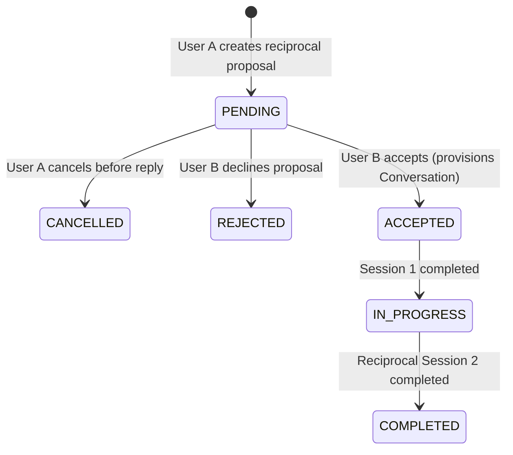
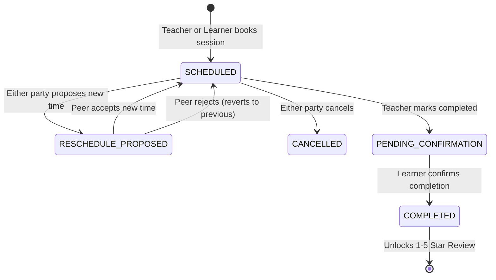
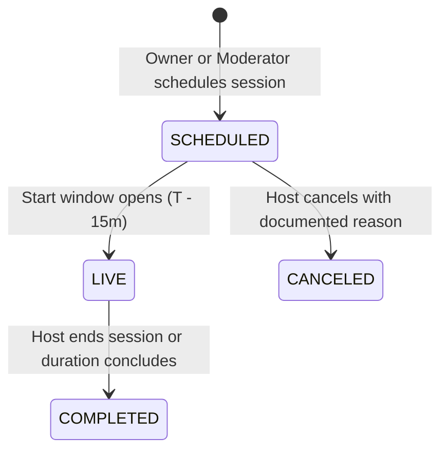
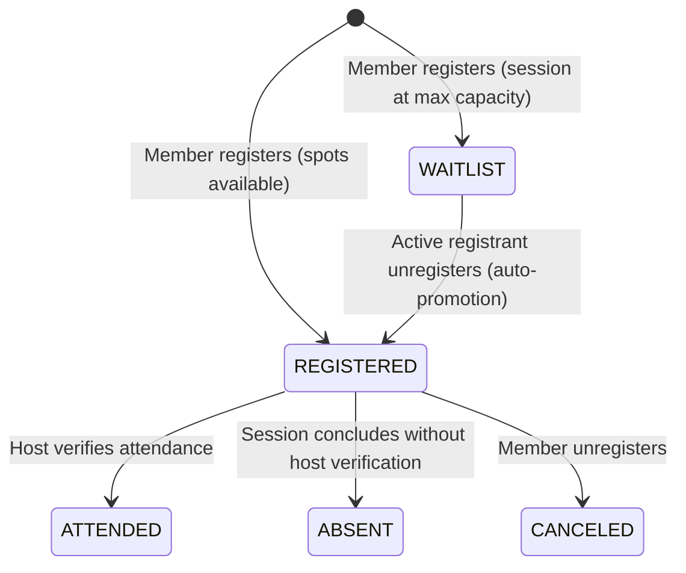

# SkillSwap — Database Design & Data Architecture

**Engine:** PostgreSQL 15+  
**ORM:** Prisma v8 RC contract-driven ORM (`@prisma/orm-postgres 8.0.0-rc.14`)  
**Contract Verification:** Zero schema drift verified via `npx prisma db verify`

---

## 1. Entity-Relationship Diagram (ERD)

```mermaid
erDiagram
    User ||--o{ UserTeachingSkill : "teaches"
    User ||--o{ UserLearningSkill : "learns"
    User ||--o{ UserAvailability : "schedules"
    User ||--o{ NotificationPreference : "configures"
    User ||--o{ Notification : "receives"
    User ||--o{ UserReport : "reports"
    User ||--o{ UserReport : "reported in"
    User ||--o{ AdminAuditLog : "actions executed by"
    
    Skill ||--o{ UserTeachingSkill : "catalogued in"
    Skill ||--o{ UserLearningSkill : "catalogued in"
    Skill ||--o{ SwapRequest : "sender skill"
    Skill ||--o{ SwapRequest : "receiver skill"
    Skill ||--o{ Session : "taught in"

    User ||--o{ SwapRequest : "sends"
    User ||--o{ SwapRequest : "receives"

    SwapRequest ||--o| Conversation : "provisions"
    SwapRequest ||--o{ Session : "coordinates"

    User ||--o{ Conversation : "user1"
    User ||--o{ Conversation : "user2"
    Conversation ||--o{ Message : "contains"
    User ||--o{ Message : "authors"

    User ||--o{ Session : "teaches"
    User ||--o{ Session : "learns"
    Session ||--o| Review : "generates"
    User ||--o{ Review : "authored by"
    User ||--o{ Review : "subject of"

    User ||--o{ CommunityPost : "authors"
    User ||--o{ CommunityComment : "authors"
    User ||--o{ CommunityVote : "casts"
    User ||--o{ StudyGroup : "owns"
    User ||--o{ StudyGroupMember : "memberships"
    User ||--o{ PushSubscription : "registers"
    User ||--o{ PushDeliveryLog : "delivery audit"
    CommunityPost ||--o{ CommunityComment : "comments"
    CommunityPost ||--o{ CommunityVote : "votes"
    CommunityComment ||--o{ CommunityVote : "votes"
    StudyGroup ||--o{ StudyGroupMember : "members"
    StudyGroup ||--o{ CommunityPost : "posts"
    StudyGroup ||--o{ GroupSession : "hosts"
    StudyGroup ||--o{ GroupResource : "shares"
    StudyGroup ||--o{ GroupTask : "organizes"
    StudyGroup ||--o{ GroupMilestone : "tracks"
    StudyGroup ||--o{ GroupMessage : "discusses"
    StudyGroup ||--o{ GroupAnnouncement : "broadcasts"

    GroupSession ||--o{ GroupSessionParticipant : "registers"
    User ||--o{ GroupSession : "hosts"
    User ||--o{ GroupSessionParticipant : "attends"
    User ||--o{ GroupResource : "uploads"
    User ||--o{ GroupTask : "assigns"
    User ||--o{ GroupMessage : "sends"
    User ||--o{ GroupAnnouncement : "authors"

    User {
        int id PK
        string email UK
        string username UK
        string name
        string passwordHash
        string bio
        string location
        string timezone
        string role
        string subscriptionTier
        boolean isSuspended
        datetime suspendedAt
        string suspendedReason
        int suspendedBy FK
        boolean isOnboarded
        boolean isDeactivated
        float averageRating
        int reviewCount
        int completedSessions
        string resetTokenHash
        datetime resetTokenExpiresAt
        datetime createdAt
        datetime updatedAt
    }

    Skill {
        int id PK
        string name UK
        string category
        string description
        boolean isDisabled
        datetime createdAt
    }


    UserTeachingSkill {
        int id PK
        int userId FK
        int skillId FK
        string proficiencyLevel
        datetime createdAt
    }

    UserLearningSkill {
        int id PK
        int userId FK
        int skillId FK
        string targetLevel
        datetime createdAt
    }

    UserAvailability {
        int id PK
        int userId FK
        string day
        json slots
        datetime createdAt
        datetime updatedAt
    }

    SwapRequest {
        int id PK
        int senderId FK
        int receiverId FK
        int senderSkillId FK
        int receiverSkillId FK
        string status
        string message
        datetime createdAt
        datetime updatedAt
    }

    Conversation {
        int id PK
        int user1Id FK
        int user2Id FK
        int swapRequestId FK
        datetime createdAt
        datetime updatedAt
    }

    Message {
        int id PK
        int conversationId FK
        int senderId FK
        string content
        boolean isRead
        datetime readAt
        datetime createdAt
    }

    Session {
        int id PK
        int swapRequestId FK
        int teacherId FK
        int learnerId FK
        int skillId FK
        datetime scheduledStart
        int duration
        string status
        string notes
        string meetingRoom
        datetime proposedStart
        int proposedBy FK
        datetime completedAt
        datetime createdAt
        datetime updatedAt
    }

    Review {
        int id PK
        int sessionId FK, UK
        int authorId FK
        int targetUserId FK
        int rating
        string feedback
        datetime createdAt
    }

    Notification {
        int id PK
        int userId FK
        string type
        string title
        string message
        json metadata
        boolean isRead
        datetime createdAt
    }

    NotificationPreference {
        int id PK
        int userId FK, UK
        boolean emailAlerts
        boolean swapRequestAlerts
        boolean sessionAlerts
        boolean messageAlerts
        boolean reviewAlerts
        datetime updatedAt
    }

    UserReport {
        int id PK
        int reporterId FK
        int reportedUserId FK
        string reason
        string description
        string status
        datetime resolvedAt
        int resolvedBy FK
        string adminNotes
        datetime createdAt
    }

    AdminAuditLog {
        int id PK
        int adminId FK
        string action
        string targetType
        string targetId
        json metadata
        string ipAddress
        string userAgent
        datetime createdAt
    }

    PlatformSetting {
        int id PK
        string key UK
        string value
        string description
        int updatedBy FK
        datetime updatedAt
    }

    EmailDeliveryJob {
        int id PK
        string to
        string toName
        string template
        string subject
        json payload
        string status
        int attempts
        int maxAttempts
        string lastError
        datetime sentAt
        datetime createdAt
        datetime updatedAt
    }
```

---

## 2. Model Specifications & Dictionaries

### `User` Table
The central identity and reputation model.
- `id` (SERIAL, PK): Unique user identifier.
- `email` (VARCHAR(255), UNIQUE, NOT NULL): Primary contact and login credential.
- `username` (VARCHAR(50), UNIQUE, NOT NULL): URL-safe public profile handle.
- `passwordHash` (TEXT, NOT NULL): Argon2id cryptographic hash (parameters: `t=3, m=65536, p=4`).
- `name` (VARCHAR(100), NOT NULL): Full display name.
- `bio` (TEXT, NULL): Self-description and background.
- `location` (VARCHAR(100), NULL): City, country or region.
- `timezone` (VARCHAR(50), DEFAULT 'UTC'): IANA timezone name.
- `role` (VARCHAR(20), DEFAULT 'USER'): Role-based access level (`USER`, `MODERATOR`, `ADMIN`).
- `isSuspended` (BOOLEAN, DEFAULT false): Administrative account suspension flag.
- `suspendedAt` (TIMESTAMP, NULL): Timestamp of account suspension.
- `suspendedReason` (TEXT, NULL): Administrative reason logged for suspension.
- `suspendedBy` (INT, FK -> User.id, NULL): Admin user who executed the suspension.
- `isOnboarded` (BOOLEAN, DEFAULT false): Route guard flag preventing un-onboarded platform access.
- `isDeactivated` (BOOLEAN, DEFAULT false): Soft-delete flag; suppresses account from discovery and login.
- `averageRating` (FLOAT, DEFAULT 0.0): Recalculated incrementally on review submission.
- `reviewCount` (INT, DEFAULT 0): Total verified reviews received.
- `completedSessions` (INT, DEFAULT 0): Total confirmed reciprocal sessions completed.
- `resetTokenHash` (TEXT, NULL): SHA-256 hash of password reset token.
- `resetTokenExpiresAt` (TIMESTAMP, NULL): Expiry time for reset token (1 hour window).

### `Skill` Table
Standardized catalog of tradeable peer skills.
- `id` (SERIAL, PK): Catalog skill ID.
- `name` (VARCHAR(100), UNIQUE, NOT NULL): Standardized skill title (e.g., "React Dev", "UI/UX Design").
- `category` (VARCHAR(50), NOT NULL): High-level bucket (`Development`, `Design`, `Creative`, `Business`, `Languages`).
- `description` (TEXT, NULL): Educational overview of the skill domain.
- `isDisabled` (BOOLEAN, DEFAULT false): Soft-disable toggle to hide from onboarding while preserving relational history.

### `UserTeachingSkill` Table
Skills offered by a user for peer instruction.
- `id` (SERIAL, PK)
- `userId` (INT, FK -> User.id, ON DELETE CASCADE)
- `skillId` (INT, FK -> Skill.id, ON DELETE RESTRICT)
- `proficiencyLevel` (VARCHAR(20), NOT NULL): `Beginner`, `Intermediate`, `Advanced`, `Expert`.
- **Constraint:** Unique composite `(userId, skillId)` prevents duplicate offers.

### `UserLearningSkill` Table
Skills a user desires to learn from peers.
- `id` (SERIAL, PK)
- `userId` (INT, FK -> User.id, ON DELETE CASCADE)
- `skillId` (INT, FK -> Skill.id, ON DELETE RESTRICT)
- `targetLevel` (VARCHAR(20), NOT NULL): Target proficiency goal.
- **Constraint:** Unique composite `(userId, skillId)`.

### `UserAvailability` Table
Weekly schedule grid for session coordination.
- `id` (SERIAL, PK)
- `userId` (INT, FK -> User.id, ON DELETE CASCADE)
- `day` (VARCHAR(15), NOT NULL): `Monday` through `Sunday`.
- `slots` (JSONB, NOT NULL): Array of string intervals, e.g. `["09:00 - 10:00", "14:00 - 15:00"]`.
- **Constraint:** Unique composite `(userId, day)`.

### `SwapRequest` Table
Peer-to-peer reciprocal exchange agreement.
- `id` (SERIAL, PK)
- `senderId` (INT, FK -> User.id)
- `receiverId` (INT, FK -> User.id)
- `senderSkillId` (INT, FK -> Skill.id): Skill sender teaches receiver.
- `receiverSkillId` (INT, FK -> Skill.id): Skill receiver teaches sender.
- `status` (VARCHAR(25), NOT NULL): `PENDING`, `ACCEPTED`, `REJECTED`, `CANCELLED`, `IN_PROGRESS`, `COMPLETED`.
- `message` (TEXT, NULL): Introductory message.

### `Conversation` Table
One-on-one messaging channel provisioned upon swap request acceptance.
- `id` (SERIAL, PK)
- `user1Id` (INT, FK -> User.id)
- `user2Id` (INT, FK -> User.id)
- `swapRequestId` (INT, FK -> SwapRequest.id, NULL)
- **Constraint:** Unique composite `(LEAST(user1Id, user2Id), GREATEST(user1Id, user2Id))` ensures exactly 1 conversation exists between any two users.

### `Message` Table
Persistent chat messages.
- `id` (SERIAL, PK)
- `conversationId` (INT, FK -> Conversation.id, ON DELETE CASCADE)
- `senderId` (INT, FK -> User.id)
- `content` (TEXT, NOT NULL)
- `isRead` (BOOLEAN, DEFAULT false)
- `readAt` (TIMESTAMP, NULL)
- **Index:** `(conversationId, createdAt DESC)` for sub-millisecond cursor pagination.

### `Session` Table
Coordinated learning sessions between swap partners.
- `id` (SERIAL, PK)
- `swapRequestId` (INT, FK -> SwapRequest.id)
- `teacherId` (INT, FK -> User.id)
- `learnerId` (INT, FK -> User.id)
- `skillId` (INT, FK -> Skill.id)
- `scheduledStart` (TIMESTAMP, NOT NULL)
- `duration` (INT, DEFAULT 60): Duration in minutes.
- `status` (VARCHAR(30), NOT NULL): `SCHEDULED`, `RESCHEDULE_PROPOSED`, `PENDING_CONFIRMATION`, `COMPLETED`, `CANCELLED`.
- `meetingRoom` (VARCHAR(120), NOT NULL): Jitsi Meet room identifier.
- `proposedStart` (TIMESTAMP, NULL): Stored when a reschedule is proposed.
- `proposedBy` (INT, FK -> User.id, NULL): User proposing the reschedule.
- `completedAt` (TIMESTAMP, NULL)

### `Review` Table
Verified post-session peer review and ratings.
- `id` (SERIAL, PK)
- `sessionId` (INT, FK -> Session.id, UNIQUE, NOT NULL): Exactly 1 review per session.
- `authorId` (INT, FK -> User.id): Must equal `Session.learnerId`.
- `targetUserId` (INT, FK -> User.id): Must equal `Session.teacherId`.
- `rating` (INT, NOT NULL): Integer rating 1–5.
- `feedback` (TEXT, NOT NULL): Qualitative review.

### `UserReport` Table
Community safety reports against platform users.
- `id` (SERIAL, PK)
- `reporterId` (INT, FK -> User.id): Complaining user.
- `reportedUserId` (INT, FK -> User.id): Accused user.
- `reason` (VARCHAR(50), NOT NULL): `HARASSMENT`, `SPAM`, `INAPPROPRIATE_BEHAVIOR`, `NO_SHOW`, `OFFENSIVE_CONTENT`, `OTHER`.
- `description` (TEXT, NOT NULL): Factual summary provided by reporter.
- `status` (VARCHAR(30), DEFAULT 'PENDING'): `PENDING`, `RESOLVED`, `DISMISSED`.
- `resolvedAt` (TIMESTAMP, NULL): Timestamp when ticket was closed.
- `resolvedBy` (INT, FK -> User.id, NULL): Moderator/Admin user resolving ticket.
- `adminNotes` (TEXT, NULL): Internal notes captured upon resolution.
- `createdAt` (TIMESTAMP, DEFAULT now()): Timestamp of submission.

### `AdminAuditLog` Table
Immutable audit trail of administrative actions.
- `id` (SERIAL, PK)
- `adminId` (INT, FK -> User.id): Admin user executing action.
- `action` (VARCHAR(60), NOT NULL): Action identifier (e.g. `USER_SUSPEND`, `ROLE_UPDATE`, `SKILL_CREATE`, `SETTINGS_UPDATE`).
- `targetType` (VARCHAR(40), NOT NULL): Target entity (`USER`, `REPORT`, `SKILL`, `SETTING`, `EMAIL_JOB`).
- `targetId` (VARCHAR(80), NULL): ID of target resource.
- `metadata` (JSONB, NULL): Detailed parameter payload, reason, and field diffs.
- `ipAddress` (VARCHAR(45), NULL): Client IP address.
- `userAgent` (TEXT, NULL): HTTP User-Agent string.
- `createdAt` (TIMESTAMP, DEFAULT now()): Immutable creation timestamp.

### `PlatformSetting` Table
Dynamic runtime configuration toggles.
- `id` (SERIAL, PK)
- `key` (VARCHAR(80), UNIQUE, NOT NULL): Setting key (e.g. `registration_enabled`, `maintenance_mode`, `email_notifications_enabled`).
- `value` (TEXT, NOT NULL): String serialized setting value.
- `description` (TEXT, NULL): Description of the setting effect.
- `updatedBy` (INT, FK -> User.id, NULL): Admin user modifying the setting.
- `updatedAt` (TIMESTAMP, DEFAULT now()): Last modification timestamp.

### `EmailDeliveryJob` Table
Reliable transactional email delivery queue.
- `id` (SERIAL, PK)
- `to` (VARCHAR(255), NOT NULL): Destination email address.
- `toName` (VARCHAR(150), NULL): Recipient display name.
- `template` (VARCHAR(60), NOT NULL): Email template (`WELCOME`, `PASSWORD_RESET`, `SWAP_REQUEST`, `SWAP_ACCEPTED`, `SESSION_SCHEDULED`, `SESSION_REMINDER`, `ACCOUNT_SUSPENDED`).
- `subject` (VARCHAR(255), NOT NULL): Email subject header.
- `payload` (JSONB, NOT NULL): Interpolation variables for email template.
- `status` (VARCHAR(30), DEFAULT 'PENDING'): `PENDING`, `PROCESSING`, `SENT`, `FAILED`.
- `attempts` (INT, DEFAULT 0): Delivery attempt counter.
- `maxAttempts` (INT, DEFAULT 3): Maximum retry ceiling before marking `FAILED`.
- `lastError` (TEXT, NULL): Error string from last failed attempt.
- `sentAt` (TIMESTAMP, NULL): Delivery timestamp.
- `createdAt` (TIMESTAMP, DEFAULT now())
- `updatedAt` (TIMESTAMP, DEFAULT now())

### `SubscriptionPlan` Table
Configurable SaaS subscription tiers (`FREE`, `PRO`, `PREMIUM`).
- `id` (SERIAL, PK)
- `code` (VARCHAR(50), UNIQUE): Unique plan identifier.
- `name` (VARCHAR(100), NOT NULL): Public plan display name.
- `description` (TEXT, NULL): Plan summary.
- `monthlyPriceCents` (INT, NOT NULL): Monthly pricing in minor currency units (e.g. 1500 = $15.00).
- `yearlyPriceCents` (INT, NOT NULL): Discounted annual pricing in minor currency units (e.g. 14400 = $144.00).
- `currency` (VARCHAR(10), DEFAULT 'USD')
- `isActive` (BOOLEAN, DEFAULT true)
- `features` (JSONB, NOT NULL): Array of marketing feature highlights.
- `entitlements` (JSONB, NOT NULL): Machine-readable limits (`maxActiveSwaps`, `advancedFilters`, `priorityMatching`, etc.).
- `createdAt` (TIMESTAMP, DEFAULT now())
- `updatedAt` (TIMESTAMP, DEFAULT now())

### `UserSubscription` Table
Active user subscriptions and provider references.
- `id` (SERIAL, PK)
- `userId` (INT, FK -> User.id, NOT NULL)
- `planId` (INT, FK -> SubscriptionPlan.id, NOT NULL)
- `status` (VARCHAR(50), NOT NULL): `ACTIVE`, `TRIALING`, `PAST_DUE`, `CANCELED`, `EXPIRED`.
- `billingCycle` (VARCHAR(20), NOT NULL): `MONTHLY`, `YEARLY`, `NONE`.
- `provider` (VARCHAR(50), NOT NULL): `stripe`, `mock`.
- `providerCustomerId` (VARCHAR(255), NULL): Stripe Customer ID (`cus_...`).
- `providerSubscriptionId` (VARCHAR(255), NULL): Stripe Subscription ID (`sub_...`).
- `currentPeriodStart` (TIMESTAMP, NULL): Start of current billing cycle.
- `currentPeriodEnd` (TIMESTAMP, NULL): Renewal / expiration date.
- `cancelAtPeriodEnd` (BOOLEAN, DEFAULT false): Grace period indicator.
- `canceledAt` (TIMESTAMP, NULL): Timestamp when cancellation was requested.
- `trialEndsAt` (TIMESTAMP, NULL)
- `createdAt` (TIMESTAMP, DEFAULT now())
- `updatedAt` (TIMESTAMP, DEFAULT now())

### `PaymentTransaction` Table
Immutable ledger of financial charges and refunds.
- `id` (SERIAL, PK)
- `userId` (INT, FK -> User.id, NOT NULL)
- `subscriptionId` (INT, FK -> UserSubscription.id, NULL)
- `providerPaymentId` (VARCHAR(255), NULL): Stripe Payment Intent ID (`pi_...`).
- `providerInvoiceId` (VARCHAR(255), NULL): Stripe Invoice ID (`in_...`).
- `amountCents` (INT, NOT NULL): Transaction amount in cents.
- `currency` (VARCHAR(10), DEFAULT 'USD')
- `status` (VARCHAR(50), NOT NULL): `SUCCEEDED`, `FAILED`, `PENDING`, `REFUNDED`.
- `paymentMethod` (VARCHAR(50), NULL): Card brand, last 4 digits, or sandbox.
- `errorMessage` (TEXT, NULL): Reason for payment failure.
- `createdAt` (TIMESTAMP, DEFAULT now())

### `BillingInvoice` Table
User-facing tax invoices and downloadable receipts.
- `id` (SERIAL, PK)
- `userId` (INT, FK -> User.id, NOT NULL)
- `subscriptionId` (INT, FK -> UserSubscription.id, NULL)
- `providerInvoiceId` (VARCHAR(255), NULL)
- `invoiceNumber` (VARCHAR(100), UNIQUE, NOT NULL): Human-readable sequential reference (e.g. `INV-2026-0001`).
- `amountPaidCents` (INT, NOT NULL)
- `currency` (VARCHAR(10), DEFAULT 'USD')
- `status` (VARCHAR(50), NOT NULL): `PAID`, `OPEN`, `VOID`, `UNCOLLECTIBLE`.
- `invoicePdfUrl` (VARCHAR(500), NULL): Direct link to PDF receipt.
- `hostedInvoiceUrl` (VARCHAR(500), NULL): Stripe hosted invoice page.
- `periodStart` (TIMESTAMP, NULL)
- `periodEnd` (TIMESTAMP, NULL)
- `paidAt` (TIMESTAMP, NULL)
- `createdAt` (TIMESTAMP, DEFAULT now())

### `BillingWebhookEvent` Table
Idempotent webhook delivery tracking and event deduplication.
- `id` (SERIAL, PK)
- `eventId` (VARCHAR(255), UNIQUE, NOT NULL): Stripe webhook event ID (`evt_...`).
- `eventType` (VARCHAR(100), NOT NULL): Webhook event type.
- `provider` (VARCHAR(50), NOT NULL)
- `payload` (JSONB, NOT NULL): Raw event payload.
- `processed` (BOOLEAN, DEFAULT false)
- `processedAt` (TIMESTAMP, NULL)
- `error` (TEXT, NULL)
- `createdAt` (TIMESTAMP, DEFAULT now())

### `UserUsage` Table
Feature quota consumption tracking per user.
- `id` (SERIAL, PK)
- `userId` (INT, FK -> User.id, NOT NULL)
- `activeSwapsCount` (INT, DEFAULT 0): Count of active proposals.
- `periodStart` (TIMESTAMP, NOT NULL)
- `periodEnd` (TIMESTAMP, NOT NULL)
- `createdAt` (TIMESTAMP, DEFAULT now())
- `updatedAt` (TIMESTAMP, DEFAULT now())

### `SkillAlias` Table
Approved alias mappings and canonical resolution for skills.
- `id` (SERIAL, PK)
- `alias` (VARCHAR(100), UNIQUE, NOT NULL): The colloquial or abbreviation variant.
- `canonicalSkillId` (INT, FK -> Skill.id, NOT NULL): Master skill in catalog.
- `similarityScore` (FLOAT, DEFAULT 1.0): Similarity coefficient.
- `relationshipType` (VARCHAR(50), DEFAULT 'ALIAS'): `ALIAS`, `RELATED`, `PARENT_CHILD`.
- `isApproved` (BOOLEAN, DEFAULT true)
- `createdAt` (TIMESTAMP, DEFAULT now())

### `LearningRoadmap` Table
Personalized multi-stage study and mentorship roadmaps.
- `id` (SERIAL, PK)
- `userId` (INT, FK -> User.id, NOT NULL)
- `skillId` (INT, FK -> Skill.id, NULL): Canonical skill ID.
- `skillName` (VARCHAR(100), NOT NULL)
- `currentProficiency` (VARCHAR(50), NOT NULL): `Beginner`, `Intermediate`, `Advanced`.
- `targetProficiency` (VARCHAR(50), NOT NULL): `Intermediate`, `Advanced`, `Expert`.
- `learningObjective` (TEXT, NOT NULL)
- `preferredPace` (VARCHAR(50), DEFAULT 'MODERATE'): `RELAXED`, `MODERATE`, `INTENSIVE`.
- `estimatedWeeks` (INT, DEFAULT 8)
- `status` (VARCHAR(50), DEFAULT 'ACTIVE'): `ACTIVE`, `COMPLETED`, `ARCHIVED`.
- `progressPercent` (INT, DEFAULT 0): Percentage of completed milestones (0–100).
- `createdAt` (TIMESTAMP, DEFAULT now())
- `updatedAt` (TIMESTAMP, DEFAULT now())

### `RoadmapMilestone` Table
Ordered milestone stages within a learning roadmap.
- `id` (SERIAL, PK)
- `roadmapId` (INT, FK -> LearningRoadmap.id, NOT NULL)
- `orderIndex` (INT, NOT NULL): Stage index (1, 2, 3, 4).
- `title` (VARCHAR(255), NOT NULL)
- `description` (TEXT, NULL)
- `topics` (JSONB / TEXT, NOT NULL): Array of learning concepts.
- `practiceProjects` (JSONB / TEXT, NOT NULL): Array of project prompts.
- `suggestedSessionGoals` (JSONB / TEXT, NOT NULL): Array of discussion points for mentor exchanges.
- `isCompleted` (BOOLEAN, DEFAULT false)
- `completedAt` (TIMESTAMP, NULL)
- `createdAt` (TIMESTAMP, DEFAULT now())
- `updatedAt` (TIMESTAMP, DEFAULT now())

### `RecommendationFeedback` Table
User feedback on AI recommendations for continuous ranking calibration and suppression.
- `id` (SERIAL, PK)
- `userId` (INT, FK -> User.id, NOT NULL)
- `recommendedUserId` (INT, FK -> User.id, NOT NULL)
- `feedbackType` (VARCHAR(50), NOT NULL): `HELPFUL`, `NOT_RELEVANT`, `ALREADY_CONNECTED`, `NOT_INTERESTED`.
- `reason` (TEXT, NULL)
- `createdAt` (TIMESTAMP, DEFAULT now())
- Unique constraint: `(userId, recommendedUserId)`

### `AIUsageRecord` Table
Token consumption, latency, and estimated cost observability ledger.
- `id` (SERIAL, PK)
- `userId` (INT, FK -> User.id, NOT NULL)
- `feature` (VARCHAR(50), NOT NULL): `RECOMMENDATION`, `ROADMAP_GEN`, `SMART_SCHEDULE`, `ASSISTANT_CHAT`, `SIMILARITY`.
- `provider` (VARCHAR(50), NOT NULL): `LOCAL_DETERMINISTIC`, `GEMINI`.
- `promptTokens` (INT, DEFAULT 0)
- `completionTokens` (INT, DEFAULT 0)
- `totalTokens` (INT, DEFAULT 0)
- `durationMs` (INT, DEFAULT 0)
- `estimatedCostUsd` (FLOAT, DEFAULT 0.0)
- `success` (BOOLEAN, DEFAULT true)
- `errorMessage` (TEXT, NULL)
- `createdAt` (TIMESTAMP, DEFAULT now())

### `UserXP` Table
User experience points, level progression, and title ledger.
- `id` (SERIAL, PK)
- `userId` (INT, FK -> User.id, NOT NULL, UNIQUE)
- `totalXp` (INT, DEFAULT 0)
- `level` (INT, DEFAULT 1)
- `title` (VARCHAR(100), DEFAULT 'Novice Explorer')
- `createdAt` (TIMESTAMP, DEFAULT now())
- `updatedAt` (TIMESTAMP, DEFAULT now())

### `XPTransaction` Table
Immutable audit trail of all experience point transactions.
- `id` (SERIAL, PK)
- `userId` (INT, FK -> User.id, NOT NULL)
- `amount` (INT, NOT NULL)
- `actionType` (VARCHAR(50), NOT NULL): `SESSION_LEARN`, `SESSION_TEACH`, `FIRST_SWAP`, `ROADMAP_MILESTONE`, `GOAL_COMPLETED`, `REVIEW_SUBMITTED`.
- `idempotencyKey` (VARCHAR(255), UNIQUE, NOT NULL): Ensures atomic single-award per event.
- `description` (TEXT, NOT NULL)
- `metadata` (TEXT, NULL): JSON string metadata (e.g. `{"sessionId": 12}`).
- `createdAt` (TIMESTAMP, DEFAULT now())

### `Achievement` Table
Curated platform badge catalog.
- `id` (SERIAL, PK)
- `code` (VARCHAR(50), UNIQUE, NOT NULL): e.g. `FIRST_SWAP`, `DEDICATED_LEARNER`.
- `title` (VARCHAR(100), NOT NULL)
- `description` (TEXT, NOT NULL)
- `category` (VARCHAR(50), NOT NULL): `LEARNING`, `TEACHING`, `COMMUNITY`, `ROADMAP`.
- `badgeIcon` (VARCHAR(50), DEFAULT 'Award'): Lucide icon name.
- `xpReward` (INT, DEFAULT 50)
- `criteriaType` (VARCHAR(50), NOT NULL): `SWAPS_COUNT`, `SESSIONS_LEARNED`, `SESSIONS_TAUGHT`, etc.
- `criteriaThreshold` (INT, DEFAULT 1)
- `createdAt` (TIMESTAMP, DEFAULT now())
- `updatedAt` (TIMESTAMP, DEFAULT now())

### `UserAchievement` Table
Unlocked achievements and profile showcase pinnings.
- `id` (SERIAL, PK)
- `userId` (INT, FK -> User.id, NOT NULL)
- `achievementId` (INT, FK -> Achievement.id, NOT NULL)
- `unlockedAt` (TIMESTAMP, DEFAULT now())
- `isFeatured` (BOOLEAN, DEFAULT false): Pin to public profile (max 3).
- Unique constraint: `(userId, achievementId)`

### `LearningGoal` Table
Personal user learning goals with automated progress tracking.
- `id` (SERIAL, PK)
- `userId` (INT, FK -> User.id, NOT NULL)
- `title` (VARCHAR(255), NOT NULL)
- `goalType` (VARCHAR(50), NOT NULL): `SESSIONS_COUNT`, `HOURS_COUNT`, `ROADMAP_MILESTONES`, `CUSTOM`.
- `targetValue` (INT, DEFAULT 1)
- `currentValue` (INT, DEFAULT 0)
- `unit` (VARCHAR(50), DEFAULT 'sessions')
- `skillName` (VARCHAR(100), NULL)
- `deadline` (TIMESTAMP, NULL)
- `status` (VARCHAR(50), DEFAULT 'IN_PROGRESS'): `IN_PROGRESS`, `COMPLETED`, `ABANDONED`.
- `completedAt` (TIMESTAMP, NULL)
- `createdAt` (TIMESTAMP, DEFAULT now())
- `updatedAt` (TIMESTAMP, DEFAULT now())

### `UserStreak` Table
Daily active learning streak tracking.
- `id` (SERIAL, PK)
- `userId` (INT, FK -> User.id, NOT NULL, UNIQUE)
- `currentStreak` (INT, DEFAULT 0)
- `longestStreak` (INT, DEFAULT 0)
- `lastActiveDate` (TIMESTAMP, NULL)
- `isEnabled` (BOOLEAN, DEFAULT true): User opt-out toggle.
- `createdAt` (TIMESTAMP, DEFAULT now())
- `updatedAt` (TIMESTAMP, DEFAULT now())

### `GamificationPrivacy` Table
Granular public profile privacy settings for learning analytics and achievements.
- `id` (SERIAL, PK)
- `userId` (INT, FK -> User.id, NOT NULL, UNIQUE)
- `showLevel` (BOOLEAN, DEFAULT true)
- `showBadges` (BOOLEAN, DEFAULT true)
- `showStats` (BOOLEAN, DEFAULT true)
- `showActivityHeatmap` (BOOLEAN, DEFAULT false)
- `showLearningGoals` (BOOLEAN, DEFAULT false)
- `createdAt` (TIMESTAMP, DEFAULT now())
- `updatedAt` (TIMESTAMP, DEFAULT now())

### `CommunityPost` Table
Discussion forum and question posts catalogued by category and optional study group.
- `id` (SERIAL, PK)
- `authorId` (INT, FK -> User.id, NOT NULL)
- `categoryId` (INT, FK -> Skill.id, NULLABLE - null represents general discussion)
- `studyGroupId` (INT, FK -> StudyGroup.id, NULLABLE - null represents public forum)
- `title` (VARCHAR(255), NOT NULL)
- `content` (TEXT, NOT NULL)
- `postType` (VARCHAR(50), DEFAULT 'DISCUSSION'): `DISCUSSION` | `QUESTION` | `RESOURCE`
- `tags` (JSONB, DEFAULT '[]')
- `isPinned` (BOOLEAN, DEFAULT false)
- `isLocked` (BOOLEAN, DEFAULT false)
- `isResolved` (BOOLEAN, DEFAULT false)
- `acceptedCommentId` (INT, NULLABLE)
- `upvotesCount` (INT, DEFAULT 0)
- `commentsCount` (INT, DEFAULT 0)
- `viewsCount` (INT, DEFAULT 0)
- `createdAt` (TIMESTAMP, DEFAULT now())
- `updatedAt` (TIMESTAMP, DEFAULT now())
- *Indexes:* `idx_community_post_author (authorId)`, `idx_community_post_category (categoryId)`, `idx_community_post_group (studyGroupId)`, `idx_community_post_type (postType)`

### `CommunityComment` Table
Threaded comments supporting hierarchical discussions up to depth 2 with soft-delete preserves.
- `id` (SERIAL, PK)
- `postId` (INT, FK -> CommunityPost.id, NOT NULL)
- `authorId` (INT, FK -> User.id, NOT NULL)
- `parentId` (INT, FK -> CommunityComment.id, NULLABLE - null represents top-level comment)
- `content` (TEXT, NOT NULL)
- `isAcceptedAnswer` (BOOLEAN, DEFAULT false)
- `isDeleted` (BOOLEAN, DEFAULT false)
- `upvotesCount` (INT, DEFAULT 0)
- `createdAt` (TIMESTAMP, DEFAULT now())
- `updatedAt` (TIMESTAMP, DEFAULT now())
- *Indexes:* `idx_community_comment_post (postId)`, `idx_community_comment_parent (parentId)`, `idx_community_comment_author (authorId)`

### `CommunityVote` Table
Enforces strictly one vote per user per target entity using composite unique indexes.
- `id` (SERIAL, PK)
- `userId` (INT, FK -> User.id, NOT NULL)
- `postId` (INT, FK -> CommunityPost.id, NULLABLE)
- `commentId` (INT, FK -> CommunityComment.id, NULLABLE)
- `value` (INT, DEFAULT 1): Upvote (+1)
- `createdAt` (TIMESTAMP, DEFAULT now())
- *Unique Constraints:* `idx_community_vote_post_user (postId, userId)`, `idx_community_vote_comment_user (commentId, userId)`

### `StudyGroup` Table
Collaborative learning cohorts with membership access control.
- `id` (SERIAL, PK)
- `name` (VARCHAR(255), NOT NULL)
- `description` (TEXT, NOT NULL)
- `skillId` (INT, FK -> Skill.id, NULLABLE)
- `ownerId` (INT, FK -> User.id, NOT NULL)
- `visibility` (VARCHAR(50), DEFAULT 'PUBLIC'): `PUBLIC` (instant join) | `PRIVATE` (request queue)
- `maxMembers` (INT, DEFAULT 50)
- `isDisabled` (BOOLEAN, DEFAULT false)
- `createdAt` (TIMESTAMP, DEFAULT now())
- `updatedAt` (TIMESTAMP, DEFAULT now())
- *Indexes:* `idx_study_group_owner (ownerId)`, `idx_study_group_skill (skillId)`

### `StudyGroupMember` Table
Group membership records with role hierarchy and approval state machine.
- `id` (SERIAL, PK)
- `studyGroupId` (INT, FK -> StudyGroup.id, NOT NULL)
- `userId` (INT, FK -> User.id, NOT NULL)
- `role` (VARCHAR(50), DEFAULT 'MEMBER'): `OWNER` | `MODERATOR` | `MEMBER`
- `status` (VARCHAR(50), DEFAULT 'APPROVED'): `PENDING` | `APPROVED` | `REJECTED`
- `joinedAt` (TIMESTAMP, DEFAULT now())
- *Unique Constraint:* `idx_study_group_member_unique (studyGroupId, userId)`

### `GroupSession` Table
Multi-user scheduled cohort sessions with integrated Jitsi video rooms.
- `id` (SERIAL, PK)
- `groupId` (INT, FK -> StudyGroup.id, NOT NULL)
- `hostId` (INT, FK -> User.id, NOT NULL)
- `title` (VARCHAR(255), NOT NULL)
- `description` (TEXT, NULLABLE)
- `topic` (VARCHAR(255), NULLABLE)
- `startTime` (TIMESTAMP, NOT NULL)
- `endTime` (TIMESTAMP, NOT NULL)
- `timezone` (VARCHAR(100), DEFAULT 'UTC')
- `maxParticipants` (INT, DEFAULT 20)
- `status` (VARCHAR(50), DEFAULT 'SCHEDULED'): `SCHEDULED` | `LIVE` | `COMPLETED` | `CANCELED`
- `meetingRoomId` (VARCHAR(255), NULLABLE)
- `meetingUrl` (VARCHAR(500), NULLABLE)
- `cancellationReason` (TEXT, NULLABLE)
- `createdAt` (TIMESTAMP, DEFAULT now())
- `updatedAt` (TIMESTAMP, DEFAULT now())
- *Indexes:* `idx_group_session_group (groupId)`, `idx_group_session_host (hostId)`, `idx_group_session_time (startTime, status)`

### `GroupSessionParticipant` Table
Participant registration and verified attendance tracking with waitlist support.
- `id` (SERIAL, PK)
- `sessionId` (INT, FK -> GroupSession.id, NOT NULL)
- `userId` (INT, FK -> User.id, NOT NULL)
- `status` (VARCHAR(50), DEFAULT 'REGISTERED'): `REGISTERED` | `WAITLIST` | `ATTENDED` | `ABSENT` | `CANCELED`
- `registeredAt` (TIMESTAMP, DEFAULT now())
- `attendedAt` (TIMESTAMP, NULLABLE)
- `isVerifiedAttendance` (BOOLEAN, DEFAULT false)
- `notes` (TEXT, NULLABLE)
- *Unique Constraint:* `idx_group_participant_unique (sessionId, userId)`
- *Indexes:* `idx_group_participant_session (sessionId)`, `idx_group_participant_user (userId)`

### `GroupResource` Table
Shared learning materials (links, study notes, uploaded files, and images).
- `id` (SERIAL, PK)
- `groupId` (INT, FK -> StudyGroup.id, NOT NULL)
- `uploaderId` (INT, FK -> User.id, NOT NULL)
- `title` (VARCHAR(255), NOT NULL)
- `description` (TEXT, NULLABLE)
- `resourceType` (VARCHAR(50), DEFAULT 'NOTE'): `LINK` | `NOTE` | `FILE` | `IMAGE`
- `url` (VARCHAR(1000), NULLABLE)
- `content` (TEXT, NULLABLE)
- `filePath` (VARCHAR(500), NULLABLE)
- `fileName` (VARCHAR(255), NULLABLE)
- `fileSize` (INT, NULLABLE)
- `mimeType` (VARCHAR(100), NULLABLE)
- `visibility` (VARCHAR(50), DEFAULT 'MEMBERS'): `MEMBERS` | `PUBLIC`
- `downloadCount` (INT, DEFAULT 0)
- `createdAt` (TIMESTAMP, DEFAULT now())
- `updatedAt` (TIMESTAMP, DEFAULT now())
- *Indexes:* `idx_group_resource_group (groupId)`, `idx_group_resource_uploader (uploaderId)`

### `GroupTask` Table
Collaborative task board with priority and cohort assignment.
- `id` (SERIAL, PK)
- `groupId` (INT, FK -> StudyGroup.id, NOT NULL)
- `creatorId` (INT, FK -> User.id, NOT NULL)
- `assigneeId` (INT, FK -> User.id, NULLABLE)
- `title` (VARCHAR(255), NOT NULL)
- `description` (TEXT, NULLABLE)
- `priority` (VARCHAR(50), DEFAULT 'MEDIUM'): `LOW` | `MEDIUM` | `HIGH` | `URGENT`
- `status` (VARCHAR(50), DEFAULT 'TODO'): `TODO` | `IN_PROGRESS` | `COMPLETED`
- `dueDate` (TIMESTAMP, NULLABLE)
- `completedAt` (TIMESTAMP, NULLABLE)
- `createdAt` (TIMESTAMP, DEFAULT now())
- `updatedAt` (TIMESTAMP, DEFAULT now())
- *Indexes:* `idx_group_task_group (groupId)`, `idx_group_task_assignee (assigneeId)`

### `GroupMilestone` Table
Cohort learning milestones and verified objectives.
- `id` (SERIAL, PK)
- `groupId` (INT, FK -> StudyGroup.id, NOT NULL)
- `creatorId` (INT, FK -> User.id, NOT NULL)
- `title` (VARCHAR(255), NOT NULL)
- `description` (TEXT, NULLABLE)
- `targetDate` (TIMESTAMP, NULLABLE)
- `status` (VARCHAR(50), DEFAULT 'TODO'): `TODO` | `IN_PROGRESS` | `ACHIEVED`
- `isVerified` (BOOLEAN, DEFAULT false)
- `createdAt` (TIMESTAMP, DEFAULT now())
- `updatedAt` (TIMESTAMP, DEFAULT now())
- *Indexes:* `idx_group_milestone_group (groupId)`

### `GroupMessage` Table
Real-time Socket.IO chat history for study cohorts.
- `id` (SERIAL, PK)
- `groupId` (INT, FK -> StudyGroup.id, NOT NULL)
- `senderId` (INT, FK -> User.id, NOT NULL)
- `content` (TEXT, NOT NULL)
- `createdAt` (TIMESTAMP, DEFAULT now())
- *Indexes:* `idx_group_message_group (groupId, createdAt)`

### `GroupAnnouncement` Table
Pinned and broadcast announcements published by moderators.
- `id` (SERIAL, PK)
- `groupId` (INT, FK -> StudyGroup.id, NOT NULL)
- `authorId` (INT, FK -> User.id, NOT NULL)
- `title` (VARCHAR(255), NOT NULL)
- `content` (TEXT, NOT NULL)
- `isPinned` (BOOLEAN, DEFAULT false)
- `createdAt` (TIMESTAMP, DEFAULT now())
- `updatedAt` (TIMESTAMP, DEFAULT now())
- *Indexes:* `idx_group_announcement_group (groupId, isPinned)`

### `PushSubscription` Table
Active Web Push browser endpoints compliant with RFC 8292 (VAPID).
- `id` (SERIAL, PK)
- `userId` (INT, FK -> User.id, NOT NULL)
- `endpoint` (TEXT, NOT NULL)
- `p256dh` (TEXT, NOT NULL)
- `auth` (TEXT, NOT NULL)
- `userAgent` (TEXT, NULLABLE)
- `createdAt` (TIMESTAMP, DEFAULT now())
- `updatedAt` (TIMESTAMP, DEFAULT now())
- *Constraints:* UNIQUE (`userId`, `endpoint`)
- *Indexes:* `idx_push_subscription_user (userId)`

### `PushDeliveryLog` Table
Audit ledger of all Web Push delivery attempts, statuses, and auto-pruning events.
- `id` (SERIAL, PK)
- `userId` (INT, FK -> User.id, NOT NULL)
- `endpoint` (TEXT, NOT NULL)
- `eventType` (VARCHAR(100), NOT NULL)
- `payloadJson` (TEXT, NOT NULL)
- `status` (VARCHAR(50), NOT NULL): `DELIVERED` | `EXPIRED` | `FAILED`
- `statusCode` (INT, NULLABLE)
- `errorMessage` (TEXT, NULLABLE)
- `createdAt` (TIMESTAMP, DEFAULT now())
- *Indexes:* `idx_push_delivery_log_user_created (userId, createdAt)`

### `UserNotificationPreference` Table (Updated)
Extended with browser push notification toggles.
- `pushEnabled` (BOOLEAN, DEFAULT false)
- `pushSwapRequests` (BOOLEAN, DEFAULT true)
- `pushMessages` (BOOLEAN, DEFAULT true)
- `pushSessions` (BOOLEAN, DEFAULT true)
- `pushReminders` (BOOLEAN, DEFAULT true)
- `pushGroupActivity` (BOOLEAN, DEFAULT true)

---

## 3. State Machines & Exchange Lifecycles

### Swap Request Lifecycle

### Session Lifecycle

### Group Session Lifecycle

### Group Session Participant & Waitlist Lifecycle

---

## 4. Prisma v8 RC Contract Architecture

SkillSwap uses Prisma v8 RC contract-driven data access:
1. **Schema Source:** `server/src/prisma/contract.prisma` defines models, fields, relations, and indexes.
2. **Contract Artifacts:** `npx prisma contract emit` compiles schema into:
   - `server/src/prisma/contract.json`: Serialized runtime database contract.
   - `server/src/prisma/contract.d.ts`: Strongly typed TypeScript definitions for query operations.
3. **Database Synchronization:**
   - `npx prisma db update`: Applies additive, non-destructive schema changes safely.
   - `npx prisma db verify`: Asserts 100% agreement between the database marker and compiled contract.
4. **Runtime Driver:** `postgres<Contract>({ contractJson, url })` creates a lightweight, connection-pooled execution client without binary engine bloat.

