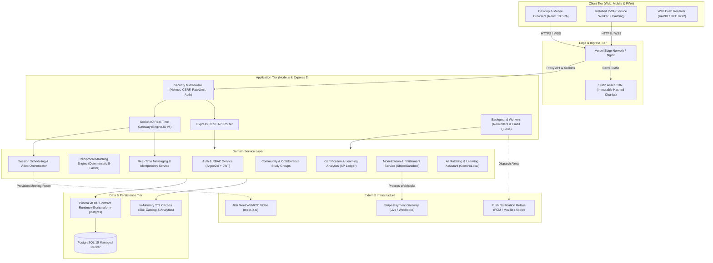
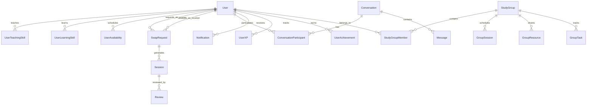
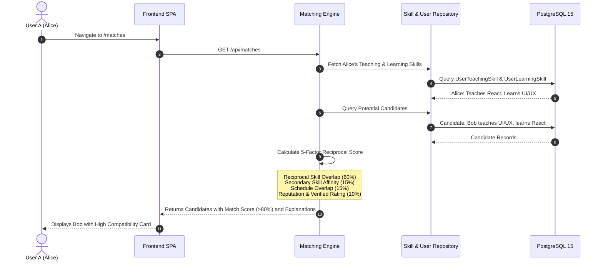
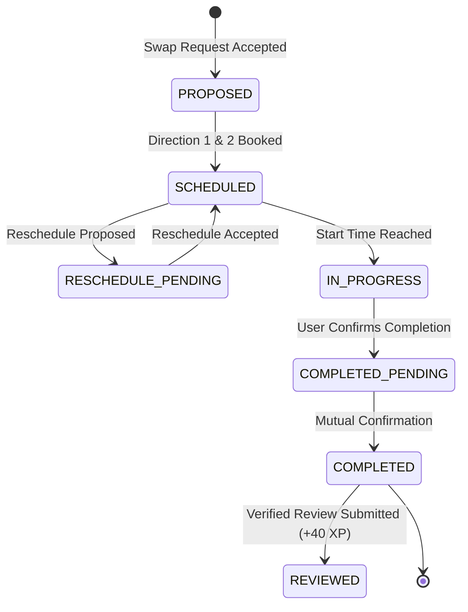
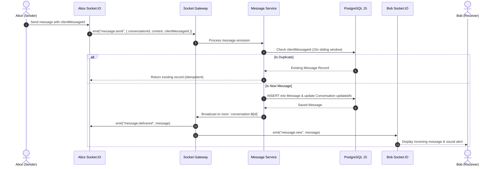
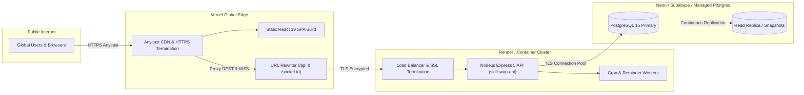

# SkillSwap — Full-Stack System Architecture & Engineering Design

**Version:** 1.0.0 (Production Release)  
**Target Environment:** Production (React 19 + Express 5 + PostgreSQL 15 + Prisma v8 RC)  
**Author:** Principal Full-Stack Engineer & Systems Architect  
**Evaluation Date:** 2026-11-06  

---

## 1. High-Level System Architecture

SkillSwap is an enterprise-grade, peer-to-peer reciprocal skill exchange and collaborative learning platform. It operates as a decoupled client-server architecture with real-time bidirectional WebSocket synchronization, relational PostgreSQL persistence, and edge reverse-proxy caching.



---

## 2. Frontend Architecture (Client Tier)

### 2.1 Technology Stack & Core Libraries
- **Core Framework:** React 19.2.8 with TypeScript 6.
- **Build Tooling:** Vite 8.3 with `@tailwindcss/vite` and functional Rollup chunking.
- **Styling & Design Tokens:** Tailwind CSS v4 design tokens, custom accessible colors, dark mode support.
- **Client Routing:** React Router v7 with 100% lazy route code-splitting (`React.lazy` + `Suspense`).
- **Server State Management:** TanStack React Query (`@tanstack/react-query`) with optimistic updates and window focus refetching.
- **Global Application State:** Zustand (`useAuthStore`) managing authentication sessions and user profiles.
- **Accessibility & Feedback:** Sonner toast manager with accessible screen-reader live regions, WCAG 2.2 AA compliant primitives.

### 2.2 Bundle Optimization & Chunk Splitting
Vite Rollup output configuration isolates vendor dependencies into distinct immutable cached chunks:

| Bundle Chunk | Modules Included | Uncompressed Size | Gzipped Size |
| :--- | :--- | :---: | :---: |
| `vendor-react` | `react`, `react-dom`, `react-router-dom` | 210.91 kB | 65.86 kB |
| `vendor-tanstack`| `@tanstack/react-query` | 34.90 kB | 10.23 kB |
| `vendor-icons` | `lucide-react` | 34.41 kB | 12.03 kB |
| `index` (Entry) | Application bootstrap, QueryClient, Zustand store | 102.39 kB | 31.38 kB |
| `index.css` | Compiled Tailwind CSS styles & animations | 108.84 kB | 16.58 kB |

### 2.3 Progressive Web App Architecture
- **Web App Manifest:** `client/public/manifest.webmanifest` defining application name, start URL `/`, standalone display, and multi-resolution vector SVG icons (`192x192`, `512x512`, maskable).
- **Service Worker (`sw.js`):**
  - Network-first caching strategy for dynamic `/api/*` endpoints.
  - Stale-while-revalidate caching for hashed static assets (`/assets/*`).
  - Precached offline application shell (`offline.html`) served automatically when disconnected.
  - Video meeting reload protection: skips service worker interference on active WebRTC Jitsi calls.
- **Web Push Notifications:** VAPID key registration via `client/src/lib/pwa/pushClient.ts` communicating with the backend push subscription manager.

---

## 3. Backend Layered Architecture (Application Tier)

The backend follows an explicit multi-layered architecture enforcing separation of concerns, strict type-safety, and centralized error handling:

```
server/src/
├── app.ts                 # Express application factory & middleware chain
├── index.ts               # Server bootstrap, HTTP listener, Socket.IO binding & graceful teardown
├── config/                # Environment schema validation (env.ts), logger (logger.ts)
├── controllers/           # HTTP controllers handling request decoding and response envelopes
├── services/              # Business logic, algorithmic scoring, transaction management
├── repositories/          # Prisma ORM data access queries and caching
├── routes/                # Route definitions with role-based and rate-limiting middleware
├── middleware/            # Auth, CSRF, security headers, rate limiters, request timeouts, error handler
├── socket/                # Socket.IO gateway, authenticated handshake, event dispatchers
├── jobs/                  # Background worker loops (session reminders, email dispatch)
├── types/                 # Domain types, DTOs, Socket payload interfaces
├── utils/                 # Cryptographic helpers, token signing, validation utilities
└── prisma/                # Prisma v8 RC contract schema, emitted JSON, and seeders
```

---

## 4. Database Architecture & Prisma v8 RC Contract Runtime

SkillSwap uses PostgreSQL 15+ managed via `@prisma/orm-postgres 8.0.0-rc.14` contract-driven runtime:
- **Contract Definition:** `server/src/prisma/contract.prisma` defines models, relations, and indexes.
- **Emitted Artifacts:** `contract.json` (abstract database AST) and `contract.d.ts` (strongly typed TypeScript client).
- **Runtime Client:** Database client initialized via `postgres<Contract>({ contractJson, url })`.
- **Integrity Verification:** Continuous contract validation using `npx prisma db verify` ensures 100% agreement between database marker and contract schema without schema drift.

### Core Entity Relationship Topology



---

## 5. Core Architectural Flows

### 5.1 Reciprocal Matching Engine Flow

The matching engine enforces reciprocal fairness by validating that User A teaches what User B wants to learn AND User B teaches what User A wants to learn.



### 5.2 Two-Direction Reciprocal Session Lifecycle



### 5.3 Real-Time Messaging & Idempotency Flow



---

## 6. Security & Defense-in-Depth Architecture

1. **Authentication & Session Security:**
   - JWT tokens signed with explicit algorithm pinning (`HS256`).
   - Stored in `httpOnly`, `Secure` (production), `SameSite=Lax` cookies.
   - Zero storage of authentication credentials in client `localStorage` or `sessionStorage`.
2. **Double-Submit CSRF Protection:**
   - State-changing HTTP methods (`POST`, `PUT`, `PATCH`, `DELETE`) require `x-csrf-token` matching the signed `skillswap_csrf` cookie.
   - Comparison executed via `crypto.timingSafeEqual` over fixed-length SHA-256 byte buffers to eliminate timing side-channel attacks.
3. **Insecure Direct Object Reference (IDOR) Hardening:**
   - Session user ID strictly enforced across all database queries for personal assets (messages, swap proposals, private study groups, billing invoices, learning roadmaps).
4. **File Upload Security & Magic-Byte Validation:**
   - Multi-user study group file uploads inspected via binary magic numbers:
     - PDF: `%PDF-`
     - PNG: `\x89PNG`
     - JPEG: `\xff\xd8\xff`
     - WebP: `RIFF...WEBP`
   - Executable binaries (`MZ`, `ELF`) blocked unconditionally; upload filenames sanitized and stored with randomized UUID identifiers.
5. **Denial of Service & Rate Limiting:**
   - Express rate limiters applied per IP: Auth endpoints (15 req/15min), API endpoints (100 req/min), AI Assistant (30 req/min).
   - Global 30-second request timeout middleware preventing thread starvation from stalled database connections.

---

## 7. Production Deployment Topology



